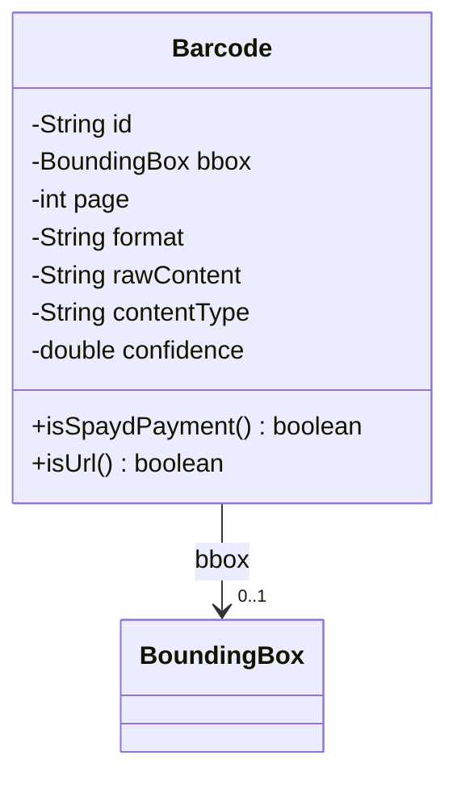
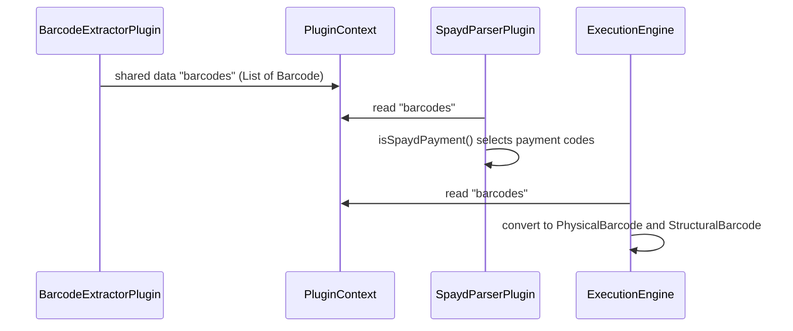

# Barcode

Barcode detected on a page. It is the working model that the barcode plugin shares with the
other plugins. The VIM document stores it converted to `PhysicalBarcode` and `StructuralBarcode`.

The JSON key order is fixed by `@JsonPropertyOrder` and lists every written key. The helper
methods `isSpaydPayment` and `isUrl` are marked with `@JsonIgnore` and are not written.

## Structure

## JSON Mapping

Keys are listed in the order they are written.

| Java field | JSON key | Type | Written |
| ---------- | -------- | ---- | ------- |
| `id` | `id` | `String` | always |
| `bbox` | `bbox` | `BoundingBox` | always |
| `page` | `page` | `int` | always |
| `format` | `format` | `String` | always |
| `rawContent` | `raw_content` | `String` | always |
| `contentType` | `content_type` | `String` | always |
| `confidence` | `confidence` | `double` | always |

## Main Flow

