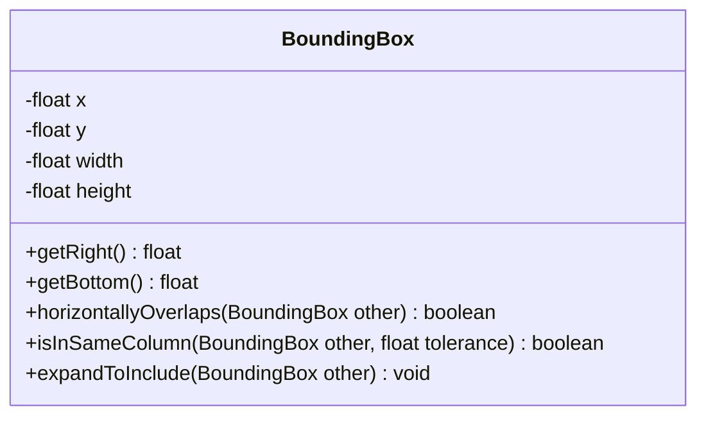
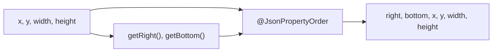
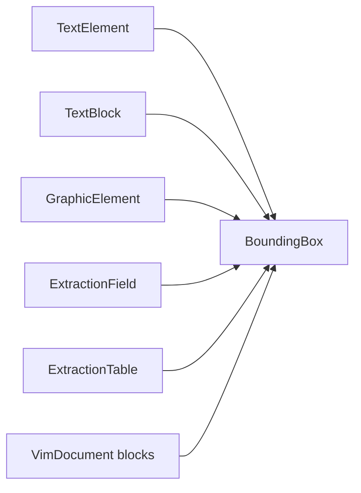

# BoundingBox

Rectangle in the PDF coordinate system, used as the `bbox` value across the VIM document.

The JSON key order is fixed by `@JsonPropertyOrder`, so every writer of a VIM document
(Java, Python in `portunix-reco`) produces the same order. `right` and `bottom` are computed
from the stored fields and are ignored on read (`ignoreUnknown`).

## Structure

## JSON Mapping

Keys are listed in the order they are written.

| JSON key | Source | Type | Written |
| -------- | ------ | ---- | ------- |
| `right` | `getRight()` | `float` | always, computed as `x + width` |
| `bottom` | `getBottom()` | `float` | always, computed as `y + height` |
| `x` | `x` | `float` | always |
| `y` | `y` | `float` | always |
| `width` | `width` | `float` | always |
| `height` | `height` | `float` | always |

## Serialization Flow

## Position in the Document

