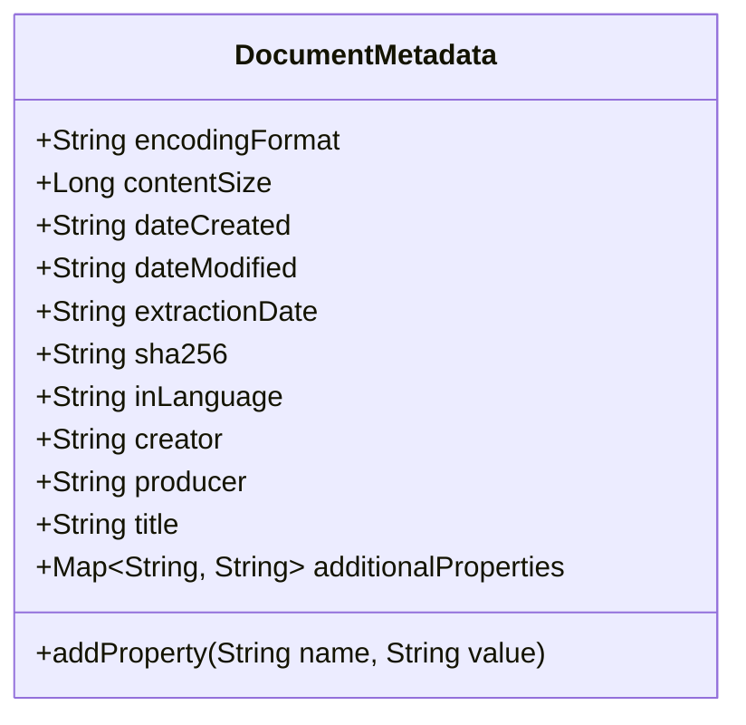
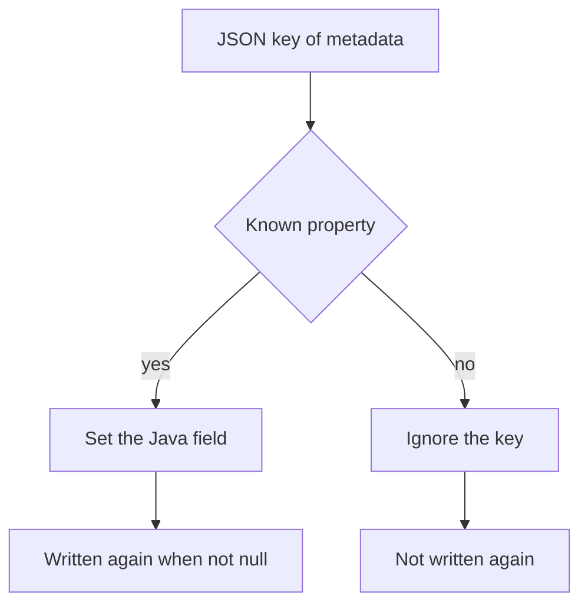
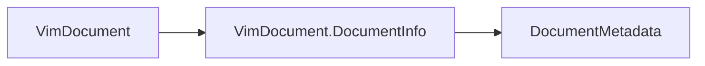

# DocumentMetadata

Metadata of the source document in a VIM document. The vocabulary follows Schema.org, with VIM
extensions.

The JSON keys match `$defs/DocumentMetadata` of the contract schema `vim-document.schema.json`.
Most keys are camelCase Schema.org names. The VIM extension `extraction_date` is snake_case.

## Structure

## JSON Mapping

The keys are written in the order of this table.

| Java field             | JSON key               | Type                  | Written        |
| ---------------------- | ---------------------- | --------------------- | -------------- |
| `encodingFormat`       | `encodingFormat`       | `String`              | when not null  |
| `contentSize`          | `contentSize`          | `Long`                | when not null  |
| `dateCreated`          | `dateCreated`          | `String`              | when not null  |
| `dateModified`         | `dateModified`         | `String`              | when not null  |
| `extractionDate`       | `extraction_date`      | `String`              | when not null  |
| `sha256`               | `sha256`               | `String`              | when not null  |
| `inLanguage`           | `inLanguage`           | `String`              | when not null  |
| `creator`              | `creator`              | `String`              | when not null  |
| `producer`             | `producer`             | `String`              | when not null  |
| `title`                | `title`                | `String`              | when not null  |
| `additionalProperties` | `additionalProperties` | `Map<String, String>` | when not empty |

`extraction_date` is the ISO 8601 timestamp of the VIM creation. The class keeps it as a string and
does not validate the format.

## Reading

A key that the class does not know is ignored and is not written again. A property added to the
schema later is therefore not a load error.

`addProperty` stores a custom name and value in `additionalProperties`. It skips a null or empty
value.

## Position in the Document

