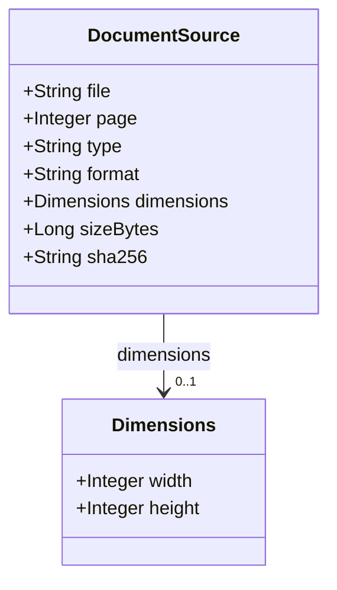
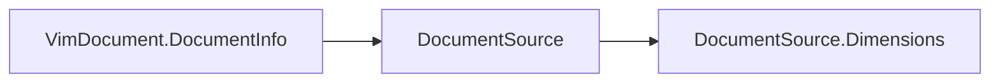

# DocumentSource

Describes a single input source contributing to a VIM v2.0 document.

The JSON keys are snake_case and match the contract schemas
(`vim-document.schema.json`, `vim-extraction*.schema.json`). The Java field names stay camelCase.

## Structure

## JSON Mapping

| Java field | JSON key | Type | Written |
| ---------- | -------- | ---- | ------- |
| `file` | `file` | `String` | when not null |
| `page` | `page` | `Integer` | when not null |
| `type` | `type` | `String` | when not null |
| `format` | `format` | `String` | when not null |
| `dimensions` | `dimensions` | `Dimensions` | when not null |
| `sizeBytes` | `size_bytes` | `Long` | when not null |
| `sha256` | `sha256` | `String` | when not null |

## Position in the Document

