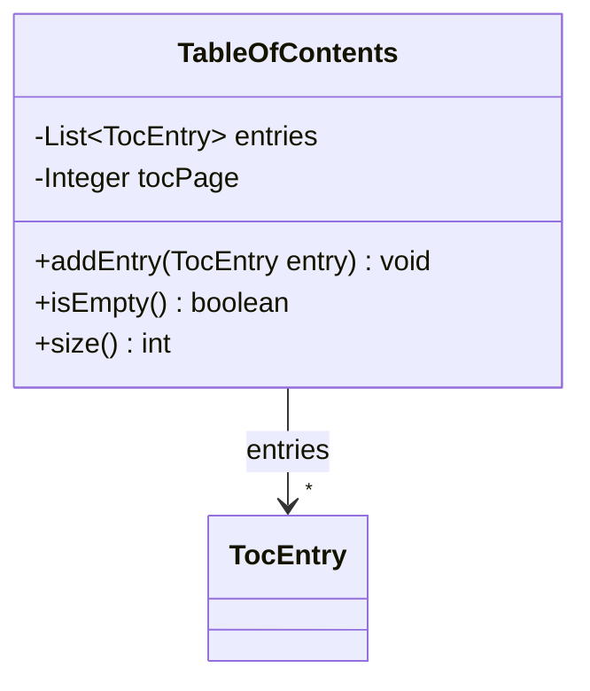
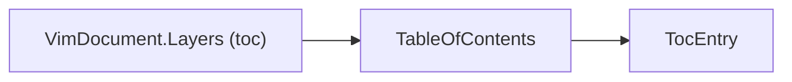

# TableOfContents

Table of contents of a document, derived from heading detection.

The JSON key order is fixed by `@JsonPropertyOrder` and equals the field declaration order.

## Structure

## JSON Mapping

Keys are listed in the order they are written.

| Java field | JSON key | Type | Written |
| ---------- | -------- | ---- | ------- |
| `entries` | `entries` | `List<TocEntry>` | always |
| `tocPage` | `toc_page` | `Integer` | when not null |

## Position in the Document

