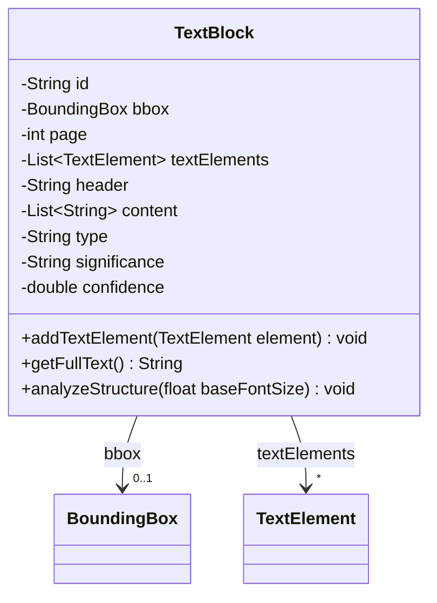
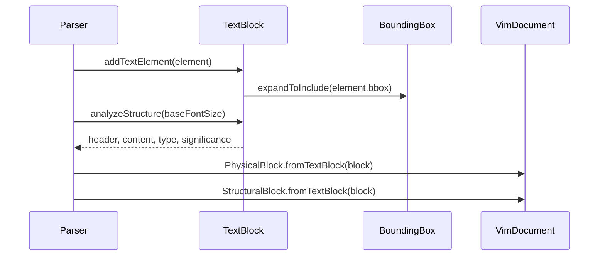

# TextBlock

Spatially grouped collection of text elements. It is the working model of the layout
analysis, the VIM document stores it converted to `PhysicalBlock` and `StructuralBlock`.

The JSON key order is fixed by `@JsonPropertyOrder` and equals the field declaration order.

## Structure

## JSON Mapping

Keys are listed in the order they are written.

| Java field | JSON key | Type | Written |
| ---------- | -------- | ---- | ------- |
| `id` | `id` | `String` | always |
| `bbox` | `bbox` | `BoundingBox` | always |
| `page` | `page` | `int` | always |
| `textElements` | `text_elements` | `List<TextElement>` | always |
| `header` | `header` | `String` | always |
| `content` | `content` | `List<String>` | always |
| `type` | `type` | `String` | always |
| `significance` | `significance` | `String` | always |
| `confidence` | `confidence` | `double` | always |

## Main Flow

