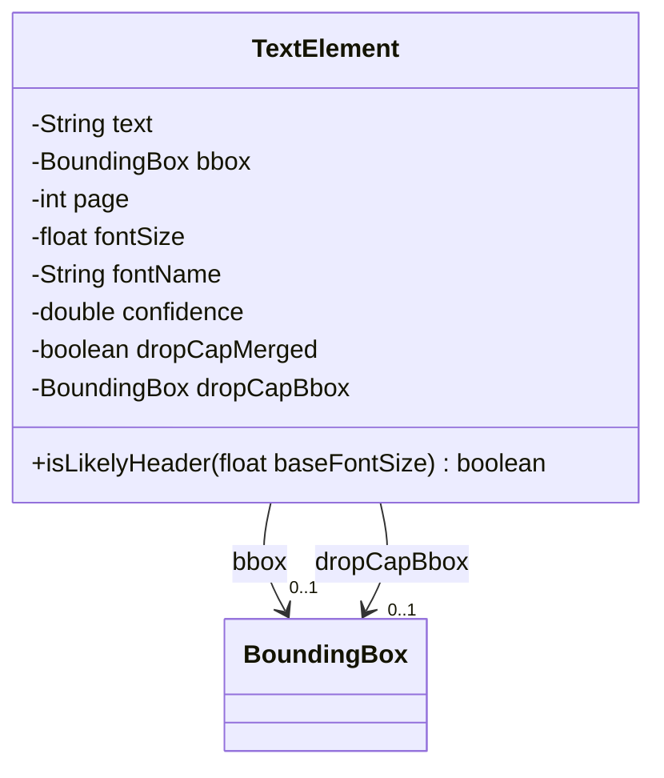
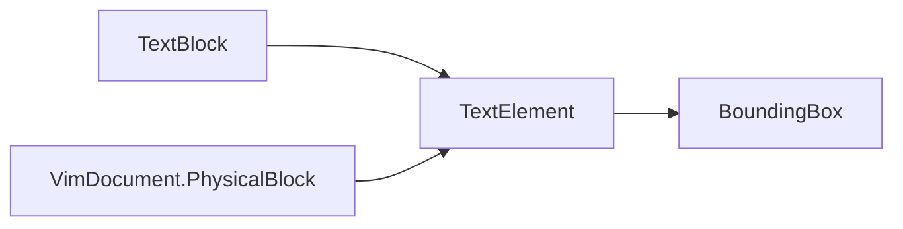

# TextElement

Single text run extracted from a PDF page, with its position and font.

The JSON key order is fixed by `@JsonPropertyOrder` and equals the field declaration order.

## Structure

## JSON Mapping

Keys are listed in the order they are written.

| Java field | JSON key | Type | Written |
| ---------- | -------- | ---- | ------- |
| `text` | `text` | `String` | always |
| `bbox` | `bbox` | `BoundingBox` | always |
| `page` | `page` | `int` | always |
| `fontSize` | `font_size` | `float` | always |
| `fontName` | `font_name` | `String` | always |
| `confidence` | `confidence` | `double` | always |
| `dropCapMerged` | `drop_cap_merged` | `boolean` | when true |
| `dropCapBbox` | `drop_cap_bbox` | `BoundingBox` | when not null |

## Position in the Document

