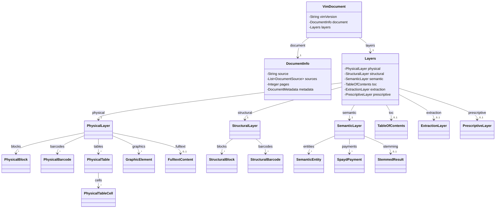
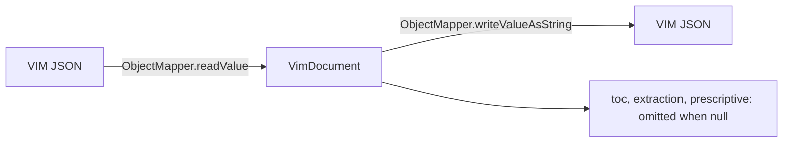

# VimDocument

Root of a VIM (Layered Information Model) document: the format version, the document info, and
the layers. The nested classes hold the physical, structural, and semantic layers. The optional
layers `toc`, `extraction`, and `prescriptive` have their own classes.

The JSON key order is fixed by `@JsonPropertyOrder` on every class. Unknown properties are
ignored on read.

## Structure

## JSON Mapping

Keys are listed in the order they are written.

| Class | Java field | JSON key | Written |
| ----- | ---------- | -------- | ------- |
| `VimDocument` | `vimVersion` | `vim_version` | always, default `1.5` |
| `VimDocument` | `document` | `document` | always |
| `VimDocument` | `layers` | `layers` | always |
| `Layers` | `physical` | `physical` | always |
| `Layers` | `structural` | `structural` | always |
| `Layers` | `semantic` | `semantic` | always |
| `Layers` | `toc` | `toc` | when not null |
| `Layers` | `extraction` | `extraction` | when not null |
| `Layers` | `prescriptive` | `prescriptive` | when not null |

## Round Trip

`vim-parser` fills the physical, structural, semantic, and `toc` layers. Other producers write
`extraction` (VIM 2.0) and `prescriptive` (VIM 2.1). The model reads and writes them without data
loss, and `vim_version` is kept as read.

