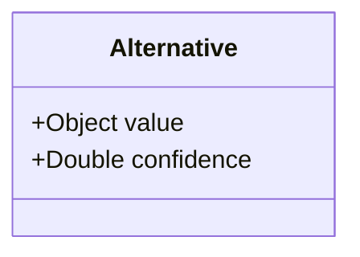
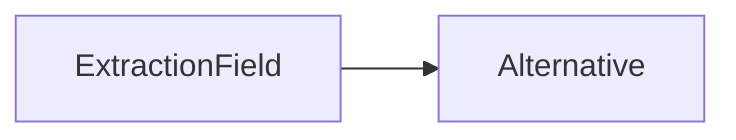

# Alternative

Alternative interpretation of an extracted value (e.g., OCR candidate).

The JSON keys are snake_case and match the contract schemas
(`vim-document.schema.json`, `vim-extraction*.schema.json`). The Java field names stay camelCase.

## Structure

## JSON Mapping

| Java field | JSON key | Type | Written |
| ---------- | -------- | ---- | ------- |
| `value` | `value` | `Object` | always, `null` included |
| `confidence` | `confidence` | `Double` | when not null |

## Position in the Document

