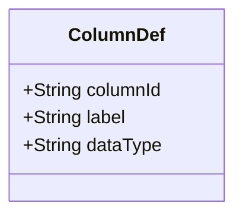
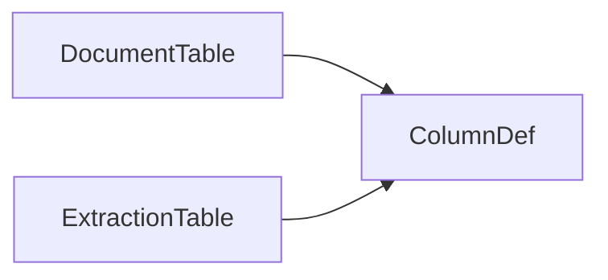

# ColumnDef

Definition of a single table column.

The JSON keys are snake_case and match the contract schemas
(`vim-document.schema.json`, `vim-extraction*.schema.json`). The Java field names stay camelCase.

## Structure

## JSON Mapping

| Java field | JSON key | Type | Written |
| ---------- | -------- | ---- | ------- |
| `columnId` | `column_id` | `String` | when not null |
| `label` | `label` | `String` | when not null |
| `dataType` | `data_type` | `String` | when not null |

## Position in the Document

