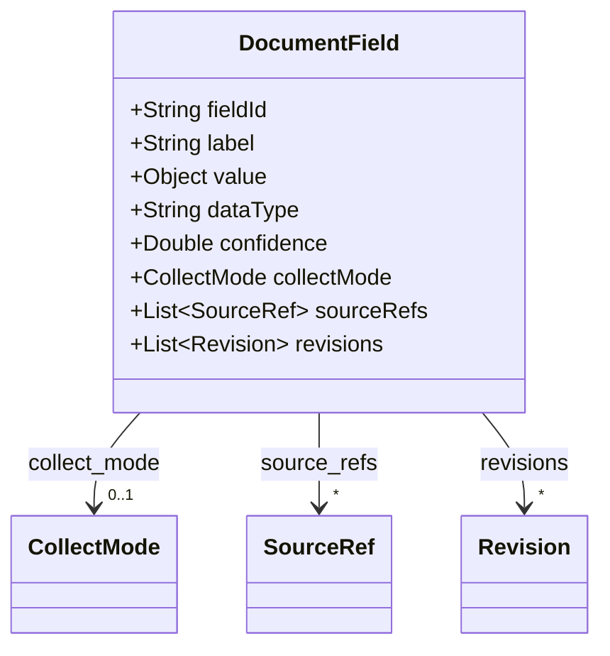
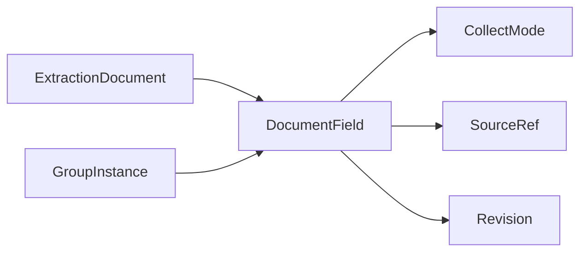

# DocumentField

Final merged field value at the document level, with references back to contributing sources.

The JSON keys are snake_case and match the contract schemas
(`vim-document.schema.json`, `vim-extraction*.schema.json`). The Java field names stay camelCase.

## Structure

## JSON Mapping

| Java field | JSON key | Type | Written |
| ---------- | -------- | ---- | ------- |
| `fieldId` | `field_id` | `String` | when not null |
| `label` | `label` | `String` | when not null |
| `value` | `value` | `Object` | always, `null` included |
| `dataType` | `data_type` | `String` | when not null |
| `confidence` | `confidence` | `Double` | when not null |
| `collectMode` | `collect_mode` | `CollectMode` | when not null |
| `sourceRefs` | `source_refs` | `List<SourceRef>` | when not empty |
| `revisions` | `revisions` | `List<Revision>` | when not empty |

## Position in the Document

