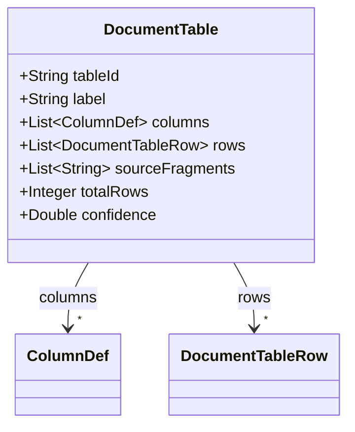
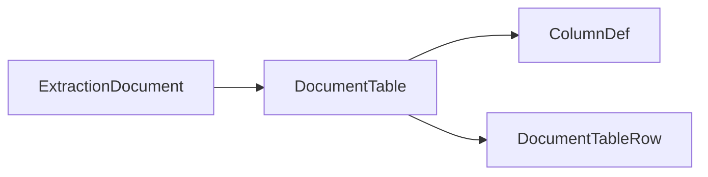

# DocumentTable

Merged table at the document level, assembled from one or more ExtractionTable fragments.

The JSON keys are snake_case and match the contract schemas
(`vim-document.schema.json`, `vim-extraction*.schema.json`). The Java field names stay camelCase.

## Structure

## JSON Mapping

| Java field | JSON key | Type | Written |
| ---------- | -------- | ---- | ------- |
| `tableId` | `table_id` | `String` | when not null |
| `label` | `label` | `String` | when not null |
| `columns` | `columns` | `List<ColumnDef>` | always |
| `rows` | `rows` | `List<DocumentTableRow>` | always |
| `sourceFragments` | `source_fragments` | `List<String>` | when not empty |
| `totalRows` | `total_rows` | `Integer` | when not null |
| `confidence` | `confidence` | `Double` | when not null |

## Position in the Document

