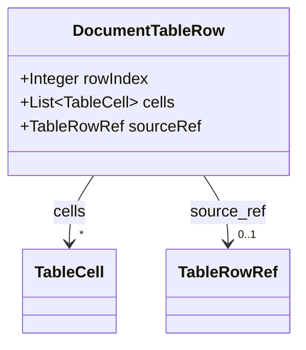
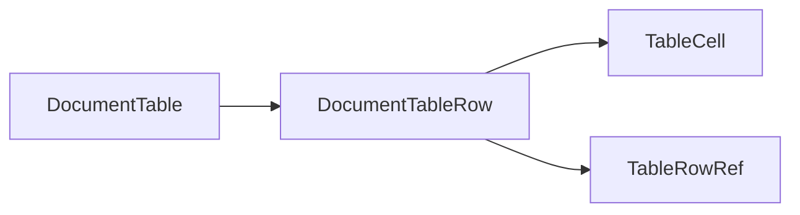

# DocumentTableRow

Row in a merged document-level table, with reference back to its originating source row.

The JSON keys are snake_case and match the contract schemas
(`vim-document.schema.json`, `vim-extraction*.schema.json`). The Java field names stay camelCase.

## Structure

## JSON Mapping

| Java field | JSON key | Type | Written |
| ---------- | -------- | ---- | ------- |
| `rowIndex` | `row_index` | `Integer` | when not null |
| `cells` | `cells` | `List<TableCell>` | always |
| `sourceRef` | `source_ref` | `TableRowRef` | when not null |

## Position in the Document

