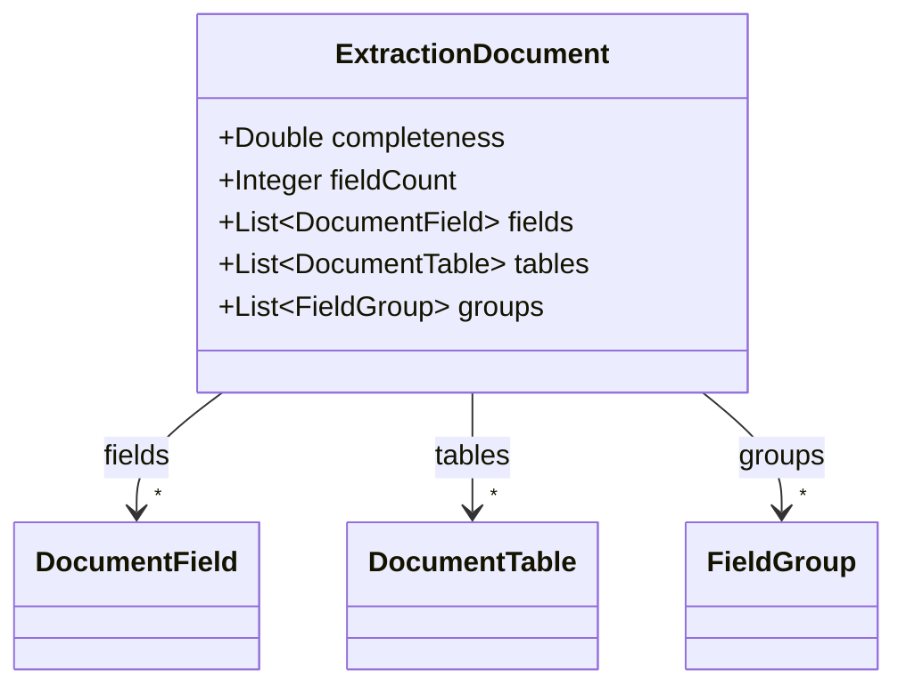
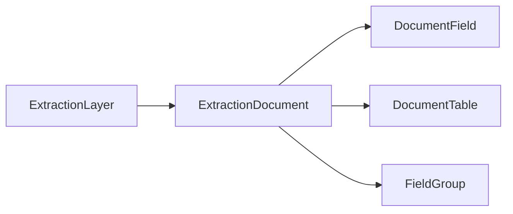

# ExtractionDocument

Document-level merged extraction result — fields, tables, and repeating groups after collecting from
all sources.

The JSON keys are snake_case and match the contract schemas
(`vim-document.schema.json`, `vim-extraction*.schema.json`). The Java field names stay camelCase.

## Structure

## JSON Mapping

| Java field | JSON key | Type | Written |
| ---------- | -------- | ---- | ------- |
| `completeness` | `completeness` | `Double` | when not null |
| `fieldCount` | `field_count` | `Integer` | when not null |
| `fields` | `fields` | `List<DocumentField>` | when not empty |
| `tables` | `tables` | `List<DocumentTable>` | when not empty |
| `groups` | `groups` | `List<FieldGroup>` | when not empty |

## Position in the Document

