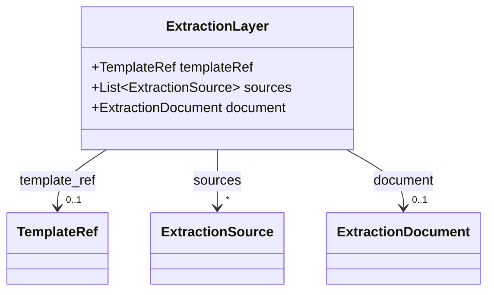
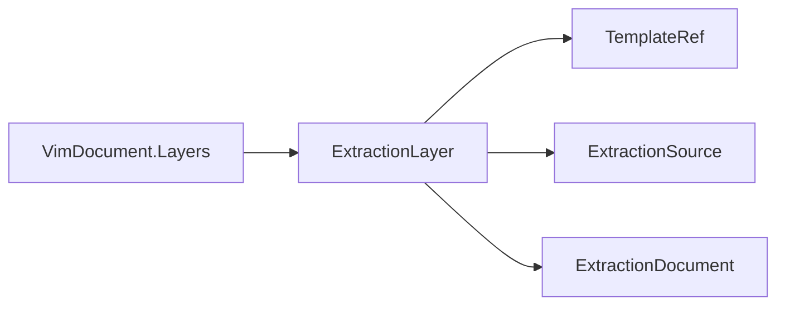

# ExtractionLayer

Top-level extraction layer for VIM v2.0 — template-driven results produced by reco, OCR engines, or
other tools.

The JSON keys are snake_case and match the contract schemas
(`vim-document.schema.json`, `vim-extraction*.schema.json`). The Java field names stay camelCase.

## Structure

## JSON Mapping

| Java field | JSON key | Type | Written |
| ---------- | -------- | ---- | ------- |
| `templateRef` | `template_ref` | `TemplateRef` | when not null |
| `sources` | `sources` | `List<ExtractionSource>` | always |
| `document` | `document` | `ExtractionDocument` | when not null |

## Position in the Document

