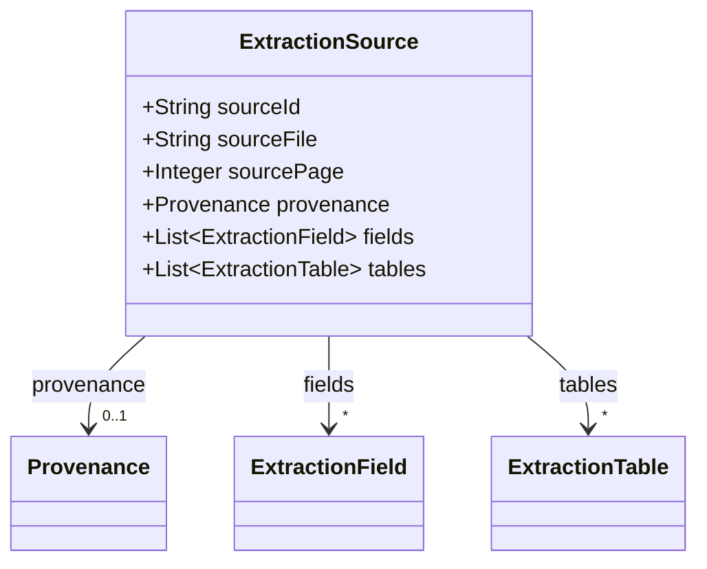
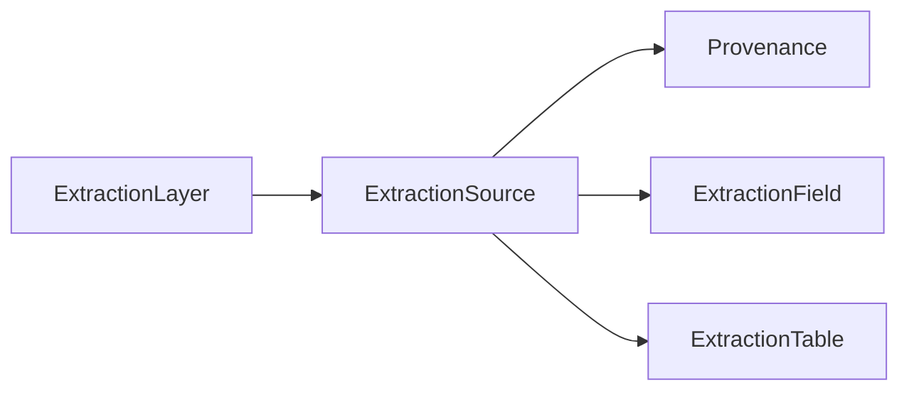

# ExtractionSource

Per-source extraction result — fields and tables read from one input.

The JSON keys are snake_case and match the contract schemas
(`vim-document.schema.json`, `vim-extraction*.schema.json`). The Java field names stay camelCase.

## Structure

## JSON Mapping

| Java field | JSON key | Type | Written |
| ---------- | -------- | ---- | ------- |
| `sourceId` | `source_id` | `String` | when not null |
| `sourceFile` | `source_file` | `String` | when not null |
| `sourcePage` | `source_page` | `Integer` | when not null |
| `provenance` | `provenance` | `Provenance` | when not null |
| `fields` | `fields` | `List<ExtractionField>` | when not empty |
| `tables` | `tables` | `List<ExtractionTable>` | when not empty |

## Position in the Document

