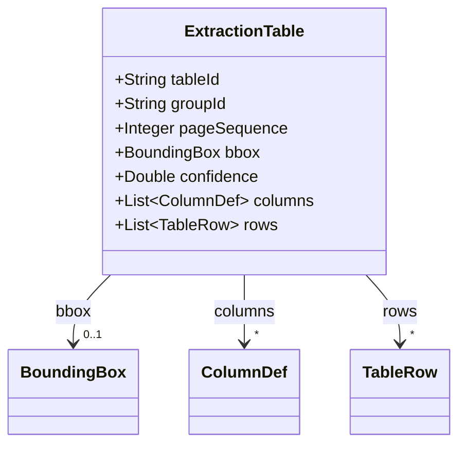
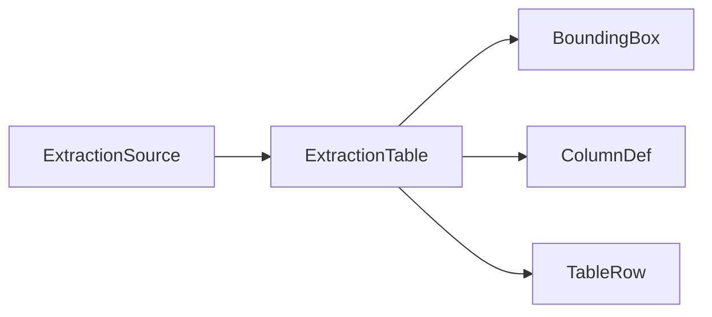

# ExtractionTable

Table fragment extracted from one source, possibly part of a multi-source group.

The JSON keys are snake_case and match the contract schemas
(`vim-document.schema.json`, `vim-extraction*.schema.json`). The Java field names stay camelCase.

## Structure

## JSON Mapping

| Java field | JSON key | Type | Written |
| ---------- | -------- | ---- | ------- |
| `tableId` | `table_id` | `String` | when not null |
| `groupId` | `group_id` | `String` | when not null |
| `pageSequence` | `page_sequence` | `Integer` | when not null |
| `bbox` | `bbox` | `BoundingBox` | when not null |
| `confidence` | `confidence` | `Double` | when not null |
| `columns` | `columns` | `List<ColumnDef>` | always |
| `rows` | `rows` | `List<TableRow>` | always |

## Position in the Document

