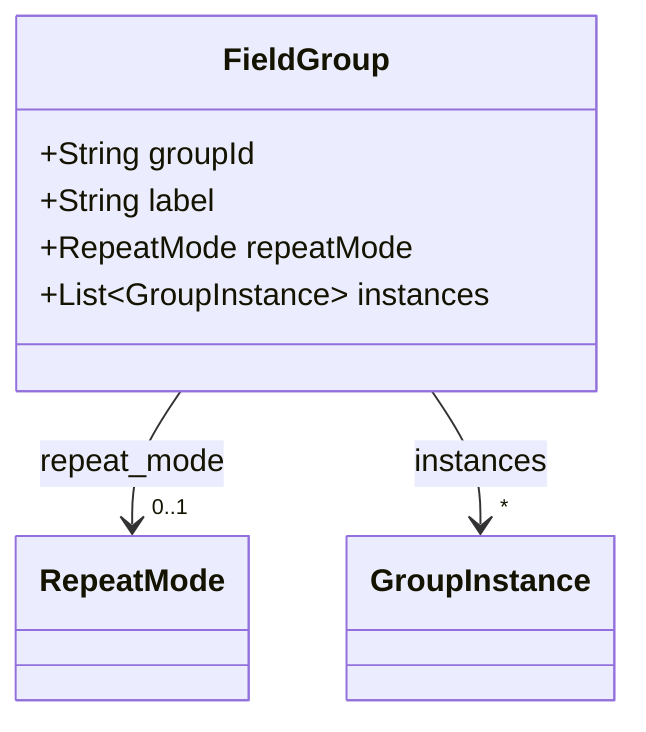
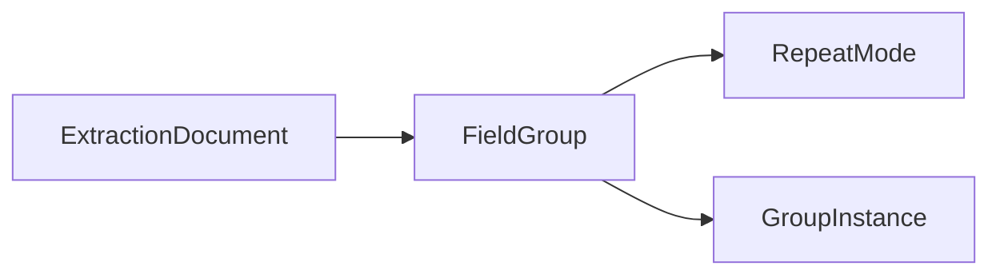

# FieldGroup

Repeating field group, expanded to one or more instances.

The JSON keys are snake_case and match the contract schemas
(`vim-document.schema.json`, `vim-extraction*.schema.json`). The Java field names stay camelCase.

## Structure

## JSON Mapping

| Java field | JSON key | Type | Written |
| ---------- | -------- | ---- | ------- |
| `groupId` | `group_id` | `String` | when not null |
| `label` | `label` | `String` | when not null |
| `repeatMode` | `repeat_mode` | `RepeatMode` | when not null |
| `instances` | `instances` | `List<GroupInstance>` | always |

## Position in the Document

