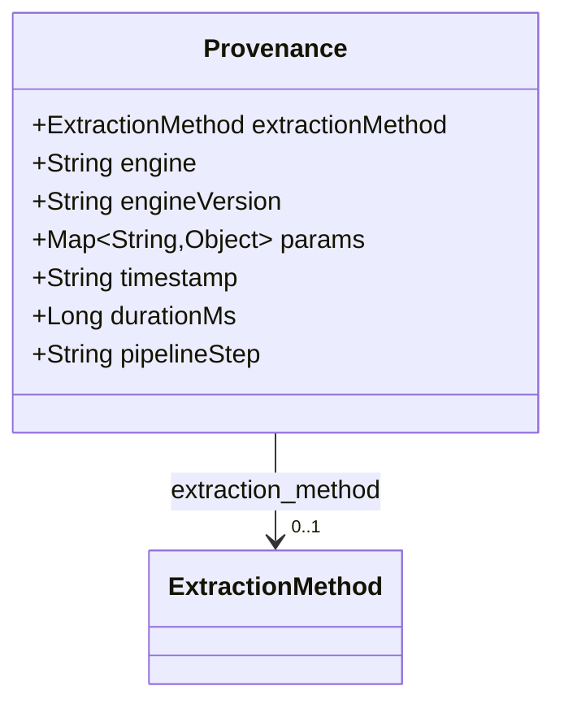
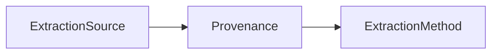

# Provenance

Context describing how a value was produced (engine, parameters, timing).

The JSON keys are snake_case and match the contract schemas
(`vim-document.schema.json`, `vim-extraction*.schema.json`). The Java field names stay camelCase.

## Structure

## JSON Mapping

| Java field | JSON key | Type | Written |
| ---------- | -------- | ---- | ------- |
| `extractionMethod` | `extraction_method` | `ExtractionMethod` | when not null |
| `engine` | `engine` | `String` | when not null |
| `engineVersion` | `engine_version` | `String` | when not null |
| `params` | `params` | `Map<String, Object>` | when not empty |
| `timestamp` | `timestamp` | `String` | when not null |
| `durationMs` | `duration_ms` | `Long` | when not null |
| `pipelineStep` | `pipeline_step` | `String` | when not null |

## Position in the Document

