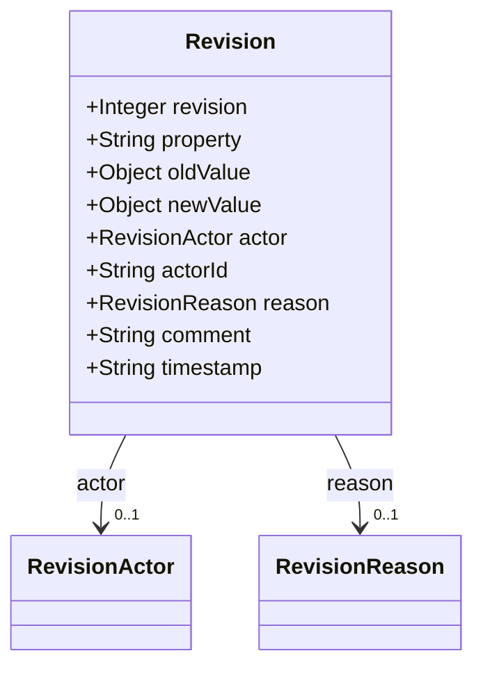
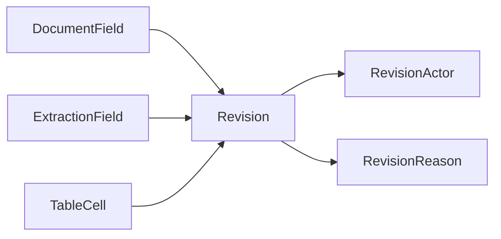

# Revision

Single audit-trail entry describing a value change.

The JSON keys are snake_case and match the contract schemas
(`vim-document.schema.json`, `vim-extraction*.schema.json`). The Java field names stay camelCase.

## Structure

## JSON Mapping

| Java field | JSON key | Type | Written |
| ---------- | -------- | ---- | ------- |
| `revision` | `revision` | `Integer` | when not null |
| `property` | `property` | `String` | when not null |
| `oldValue` | `old_value` | `Object` | always, `null` included |
| `newValue` | `new_value` | `Object` | always, `null` included |
| `actor` | `actor` | `RevisionActor` | when not null |
| `actorId` | `actor_id` | `String` | when not null |
| `reason` | `reason` | `RevisionReason` | when not null |
| `comment` | `comment` | `String` | when not null |
| `timestamp` | `timestamp` | `String` | when not null |

## Position in the Document

