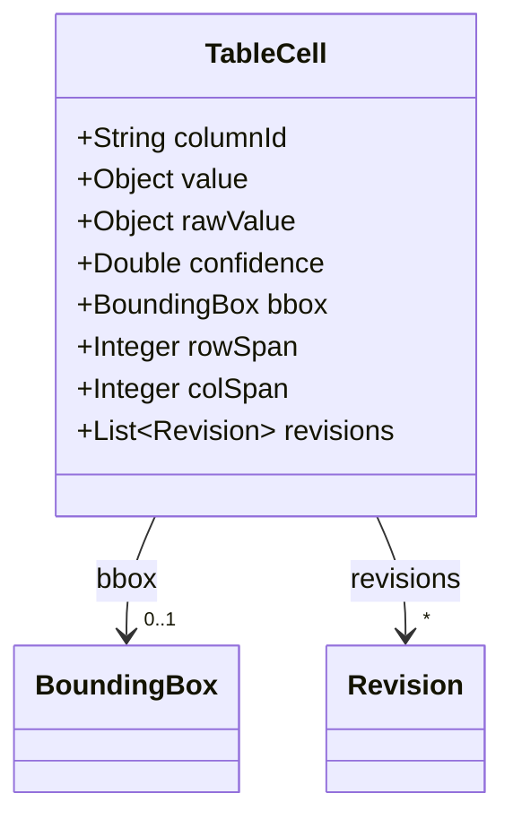
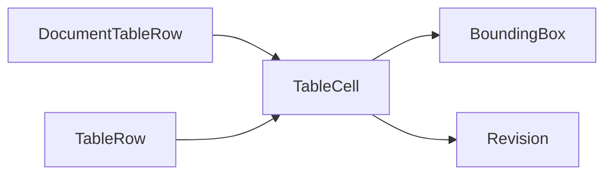

# TableCell

Single cell in an extraction-layer table fragment.

The JSON keys are snake_case and match the contract schemas
(`vim-document.schema.json`, `vim-extraction*.schema.json`). The Java field names stay camelCase.

## Structure

## JSON Mapping

| Java field | JSON key | Type | Written |
| ---------- | -------- | ---- | ------- |
| `columnId` | `column_id` | `String` | when not null |
| `value` | `value` | `Object` | always, `null` included |
| `rawValue` | `raw_value` | `Object` | when not null |
| `confidence` | `confidence` | `Double` | when not null |
| `bbox` | `bbox` | `BoundingBox` | when not null |
| `rowSpan` | `row_span` | `Integer` | when not null |
| `colSpan` | `col_span` | `Integer` | when not null |
| `revisions` | `revisions` | `List<Revision>` | when not empty |

## Numeric Precision

`value` and `raw_value` are untyped. A default Jackson mapper reads a JSON number with a
fraction as `double`, so more than 17 significant digits are lost and an overflow is written
back as the string `"Infinity"`. A reader that needs exact decimals enables
`DeserializationFeature.USE_BIG_DECIMAL_FOR_FLOATS` on its mapper.

## Position in the Document

