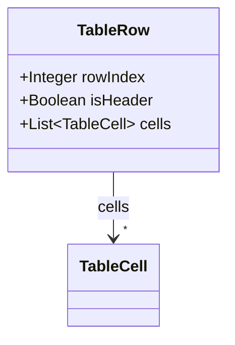
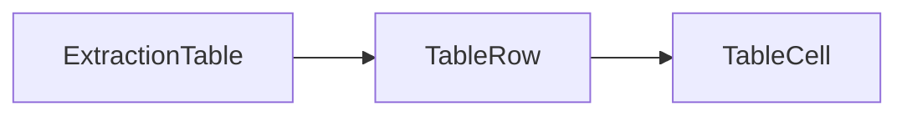

# TableRow

Single row in an extraction-layer table fragment.

The JSON keys are snake_case and match the contract schemas
(`vim-document.schema.json`, `vim-extraction*.schema.json`). The Java field names stay camelCase.

## Structure

## JSON Mapping

| Java field | JSON key | Type | Written |
| ---------- | -------- | ---- | ------- |
| `rowIndex` | `row_index` | `Integer` | when not null |
| `isHeader` | `is_header` | `Boolean` | when not null |
| `cells` | `cells` | `List<TableCell>` | always |

## Position in the Document

