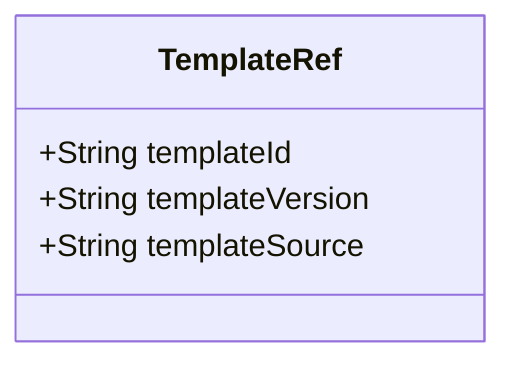
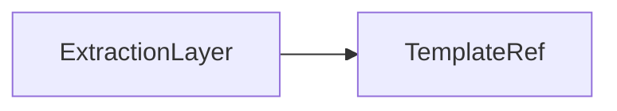

# TemplateRef

Reference to the template that drove an extraction.

The JSON keys are snake_case and match the contract schemas
(`vim-document.schema.json`, `vim-extraction*.schema.json`). The Java field names stay camelCase.

## Structure

## JSON Mapping

| Java field | JSON key | Type | Written |
| ---------- | -------- | ---- | ------- |
| `templateId` | `template_id` | `String` | when not null |
| `templateVersion` | `template_version` | `String` | when not null |
| `templateSource` | `template_source` | `String` | when not null |

## Position in the Document

