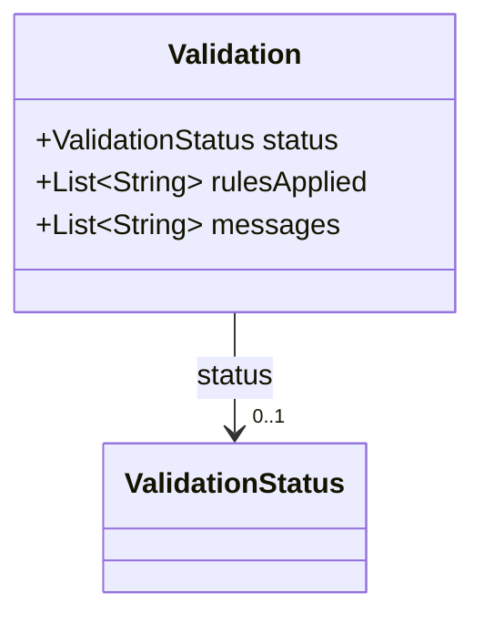
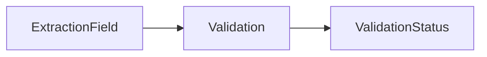

# Validation

Result of validating an extracted field.

The JSON keys are snake_case and match the contract schemas
(`vim-document.schema.json`, `vim-extraction*.schema.json`). The Java field names stay camelCase.

## Structure

## JSON Mapping

| Java field | JSON key | Type | Written |
| ---------- | -------- | ---- | ------- |
| `status` | `status` | `ValidationStatus` | when not null |
| `rulesApplied` | `rules_applied` | `List<String>` | when not empty |
| `messages` | `messages` | `List<String>` | when not empty |

## Position in the Document

