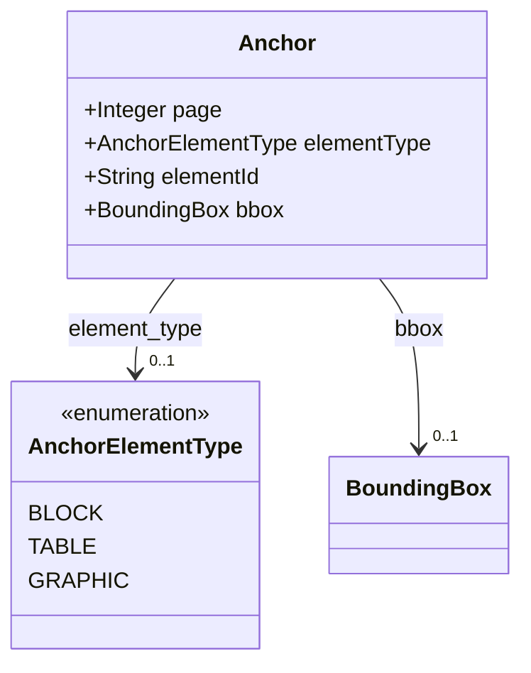
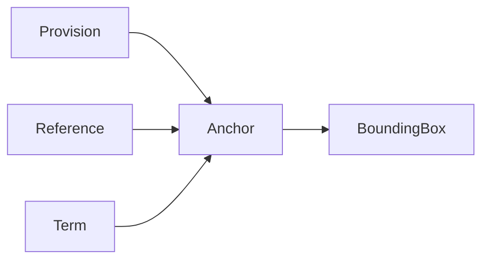

# Anchor

A place in the definition file. `page` and `bbox` are the durable anchor; `element_id` is valid
only together with the physical layer of the same document.

The JSON keys are snake_case and match the contract schemas
(`vim-document.schema.json`, `vim-prescriptive*.schema.json`). The Java field names stay camelCase.

## Structure

## JSON Mapping

| Java field | JSON key | Type | Written |
| ---------- | -------- | ---- | ------- |
| `page` | `page` | `Integer` | when not null |
| `elementType` | `element_type` | `AnchorElementType` | when not null |
| `elementId` | `element_id` | `String` | when not null |
| `bbox` | `bbox` | `BoundingBox` | when not null |

## Enum Values

Enums are written as lower snake case and read without regard to case.

| Enum | JSON values |
| ---- | ----------- |
| `AnchorElementType` | `block`, `table`, `graphic` |

## Position in the Document

