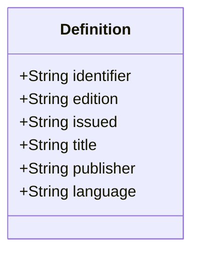
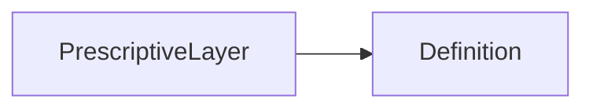

# Definition

Identity of the definition file. A reference in another VIM document can match these values.

- `issued` is an ISO 8601 date with the precision that the file gives: a year (`2008`), a year
  and month (`2008-11`), or a full date (`2008-11-01`)
- `language` is the BCP 47 tag (`cs`, `en`) of the verbatim `text` in the layer; a `statement`
  of the producer can be in another language

The JSON keys are snake_case and match the contract schemas
(`vim-document.schema.json`, `vim-prescriptive*.schema.json`). The Java field names stay camelCase.

## Structure

## JSON Mapping

| Java field | JSON key | Type | Written |
| ---------- | -------- | ---- | ------- |
| `identifier` | `identifier` | `String` | when not null |
| `edition` | `edition` | `String` | when not null |
| `issued` | `issued` | `String` | when not null |
| `title` | `title` | `String` | when not null |
| `publisher` | `publisher` | `String` | when not null |
| `language` | `language` | `String` | when not null |

## Position in the Document

