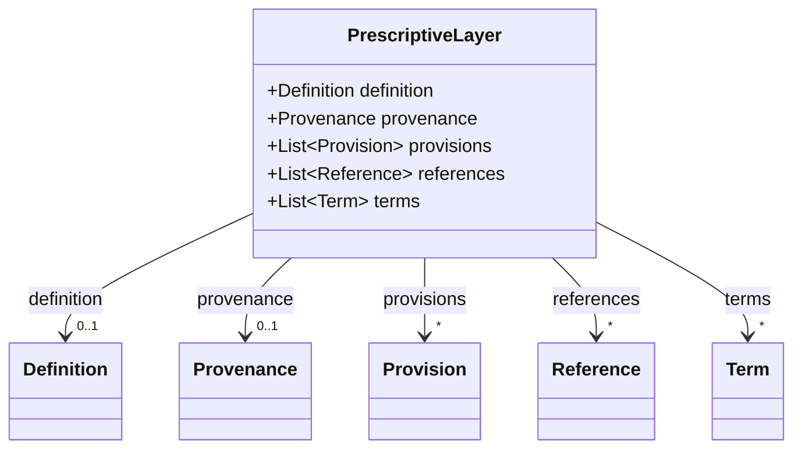
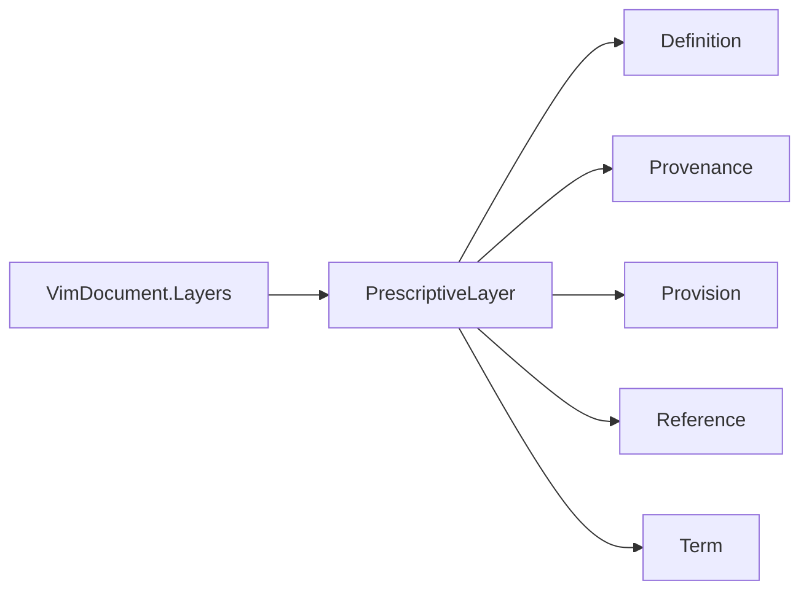

# PrescriptiveLayer

Top-level prescriptive layer for VIM v2.1 — what a definition file prescribes: provisions,
references to other documents and clauses, and defined terms. Another producer writes the layer;
`vim-parser` reads and writes it without data loss.

The JSON keys are snake_case and match the contract schemas
(`vim-document.schema.json`, `vim-prescriptive*.schema.json`). The Java field names stay camelCase.

## Structure

## JSON Mapping

| Java field | JSON key | Type | Written |
| ---------- | -------- | ---- | ------- |
| `definition` | `definition` | `Definition` | when not null |
| `provenance` | `provenance` | `Provenance` | when not null |
| `provisions` | `provisions` | `List<Provision>` | always |
| `references` | `references` | `List<Reference>` | when not empty |
| `terms` | `terms` | `List<Term>` | when not empty |

A JSON `null` for a list is read as an empty list, so the getters never return `null` after a read.

## Position in the Document

