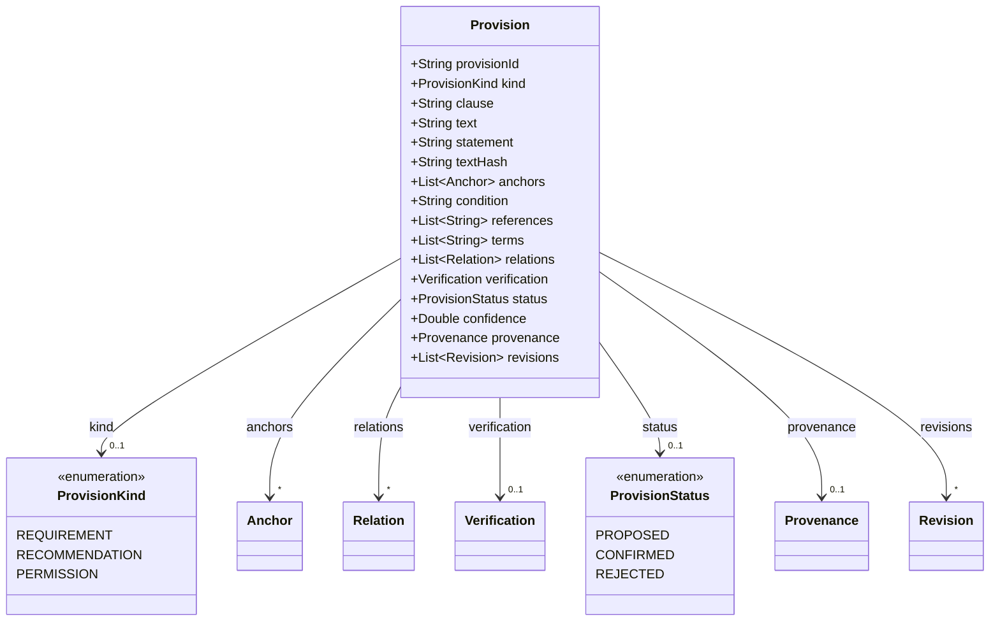
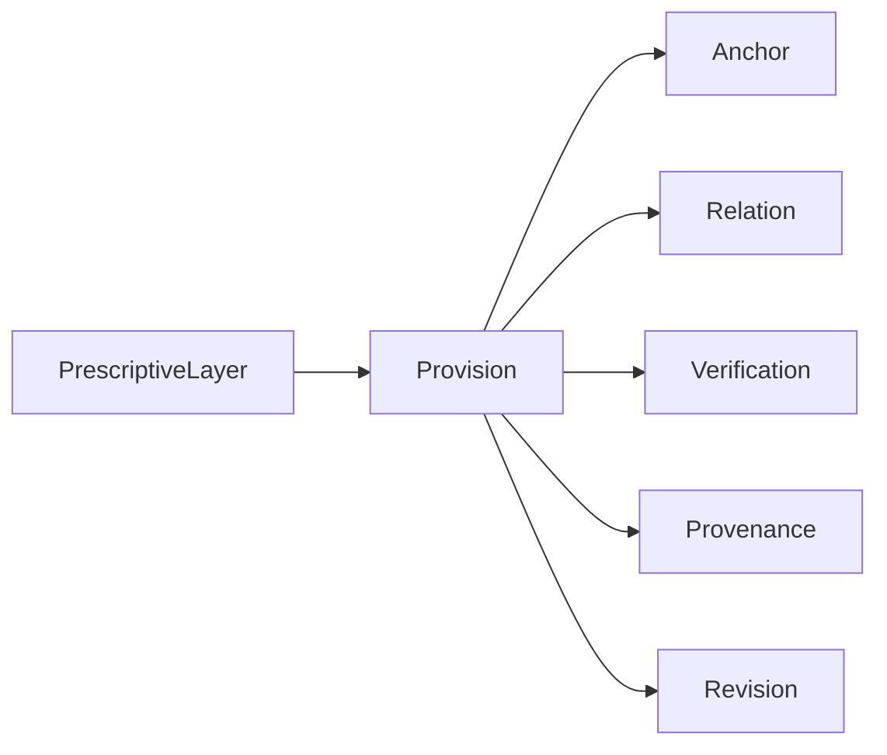

# Provision

One provision of a definition file — a statement that prescribes something, with its place in
the file, its verification and its audit trail. At least one of `text` and `statement` is present.

The JSON keys are snake_case and match the contract schemas
(`vim-document.schema.json`, `vim-prescriptive*.schema.json`). The Java field names stay camelCase.

## Structure

## JSON Mapping

| Java field | JSON key | Type | Written |
| ---------- | -------- | ---- | ------- |
| `provisionId` | `provision_id` | `String` | when not null |
| `kind` | `kind` | `ProvisionKind` | when not null |
| `clause` | `clause` | `String` | when not null |
| `text` | `text` | `String` | when not null |
| `statement` | `statement` | `String` | when not null |
| `textHash` | `text_hash` | `String` | when not null |
| `anchors` | `anchors` | `List<Anchor>` | always |
| `condition` | `condition` | `String` | when not null |
| `references` | `references` | `List<String>` | when not empty |
| `terms` | `terms` | `List<String>` | when not empty |
| `relations` | `relations` | `List<Relation>` | when not empty |
| `verification` | `verification` | `Verification` | when not null |
| `status` | `status` | `ProvisionStatus` | when not null |
| `confidence` | `confidence` | `Double` | when not null |
| `provenance` | `provenance` | `Provenance` | when not null |
| `revisions` | `revisions` | `List<Revision>` | when not empty |

A JSON `null` for a list is read as an empty list, so the getters never return `null` after a read.

## Enum Values

Enums are written as lower snake case and read without regard to case.

| Enum | JSON values |
| ---- | ----------- |
| `ProvisionKind` | `requirement`, `recommendation`, `permission` |
| `ProvisionStatus` | `proposed`, `confirmed`, `rejected` |

## Position in the Document

