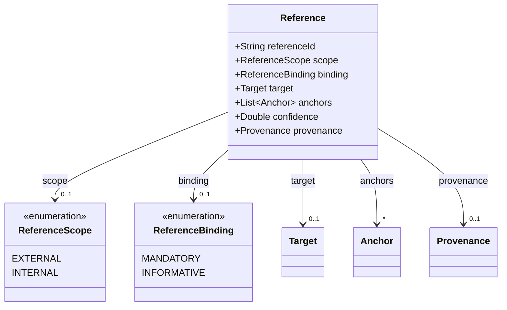
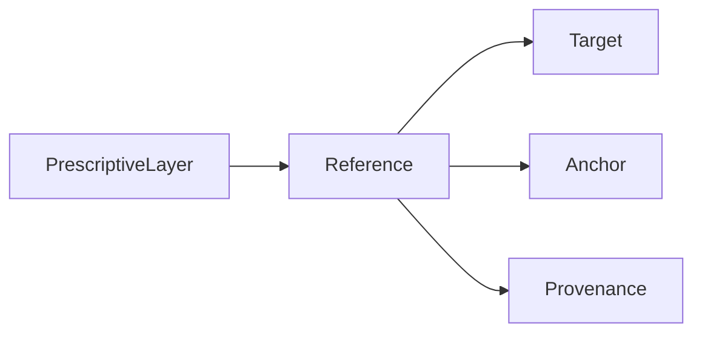

# Reference

A link from the definition file to another document or to another clause of the same file. An
external target has an identifier, an internal target has a clause.

The JSON keys are snake_case and match the contract schemas
(`vim-document.schema.json`, `vim-prescriptive*.schema.json`). The Java field names stay camelCase.

## Structure

## JSON Mapping

| Java field | JSON key | Type | Written |
| ---------- | -------- | ---- | ------- |
| `referenceId` | `reference_id` | `String` | when not null |
| `scope` | `scope` | `ReferenceScope` | when not null |
| `binding` | `binding` | `ReferenceBinding` | when not null |
| `target` | `target` | `Target` | when not null |
| `anchors` | `anchors` | `List<Anchor>` | when not empty |
| `confidence` | `confidence` | `Double` | when not null |
| `provenance` | `provenance` | `Provenance` | when not null |

A JSON `null` for a list is read as an empty list, so the getters never return `null` after a read.

## Enum Values

Enums are written as lower snake case and read without regard to case.

| Enum | JSON values |
| ---- | ----------- |
| `ReferenceScope` | `external`, `internal` |
| `ReferenceBinding` | `mandatory`, `informative` |

## Position in the Document

