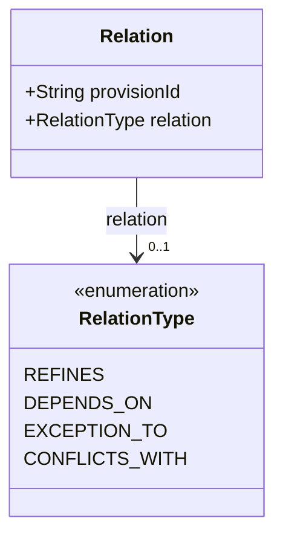
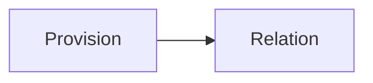

# Relation

A link from a provision to another provision of the layer.

The JSON keys are snake_case and match the contract schemas
(`vim-document.schema.json`, `vim-prescriptive*.schema.json`). The Java field names stay camelCase.

## Structure

## JSON Mapping

| Java field | JSON key | Type | Written |
| ---------- | -------- | ---- | ------- |
| `provisionId` | `provision_id` | `String` | when not null |
| `relation` | `relation` | `RelationType` | when not null |

## Enum Values

Enums are written as lower snake case and read without regard to case.

| Enum | JSON values |
| ---- | ----------- |
| `RelationType` | `refines`, `depends_on`, `exception_to`, `conflicts_with` |

## Position in the Document

