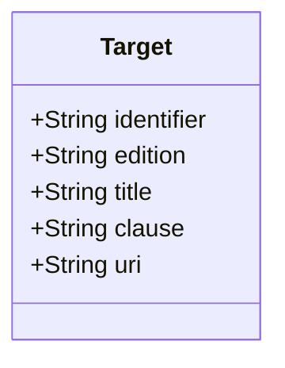
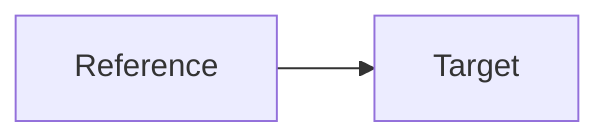

# Target

Target of a reference. An absent `edition` means any edition.

The JSON keys are snake_case and match the contract schemas
(`vim-document.schema.json`, `vim-prescriptive*.schema.json`). The Java field names stay camelCase.

## Structure

## JSON Mapping

| Java field | JSON key | Type | Written |
| ---------- | -------- | ---- | ------- |
| `identifier` | `identifier` | `String` | when not null |
| `edition` | `edition` | `String` | when not null |
| `title` | `title` | `String` | when not null |
| `clause` | `clause` | `String` | when not null |
| `uri` | `uri` | `String` | when not null |

## Position in the Document

