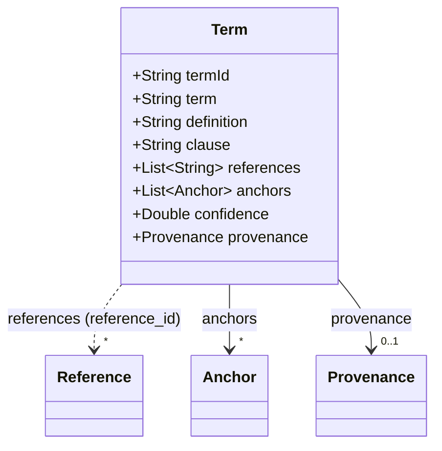
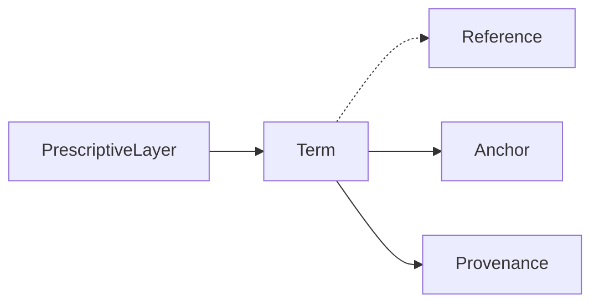

# Term

A term that provisions use. The definition file defines it, or `references` names the
`reference_id` values of the layer that point to the document that defines it (for example a
standard). `definition` may be left out for licence reasons.

The JSON keys are snake_case and match the contract schemas
(`vim-document.schema.json`, `vim-prescriptive*.schema.json`). The Java field names stay camelCase.

## Structure

## JSON Mapping

| Java field | JSON key | Type | Written |
| ---------- | -------- | ---- | ------- |
| `termId` | `term_id` | `String` | when not null |
| `term` | `term` | `String` | when not null |
| `definition` | `definition` | `String` | when not null |
| `clause` | `clause` | `String` | when not null |
| `references` | `references` | `List<String>` | when not empty |
| `anchors` | `anchors` | `List<Anchor>` | when not empty |
| `confidence` | `confidence` | `Double` | when not null |
| `provenance` | `provenance` | `Provenance` | when not null |

A JSON `null` for a list is read as an empty list, so the getters never return `null` after a read.

## Position in the Document

