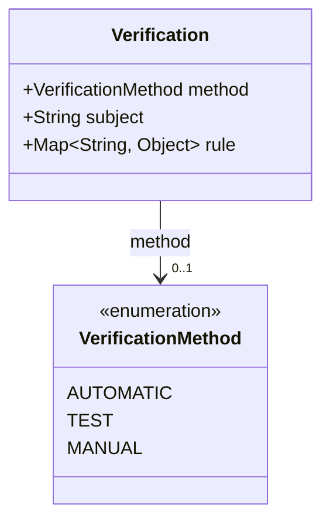
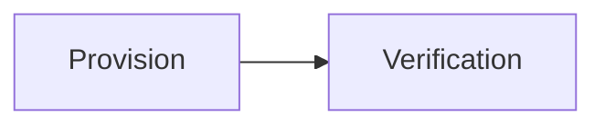

# Verification

How a provision can be checked. `rule` is an open object: no rule language is defined, the
content is an agreement between the producer and the checking tool.

The JSON keys are snake_case and match the contract schemas
(`vim-document.schema.json`, `vim-prescriptive*.schema.json`). The Java field names stay camelCase.

## Structure

## JSON Mapping

| Java field | JSON key | Type | Written |
| ---------- | -------- | ---- | ------- |
| `method` | `method` | `VerificationMethod` | when not null |
| `subject` | `subject` | `String` | when not null |
| `rule` | `rule` | `Map<String, Object>` | when not null |

## Enum Values

Enums are written as lower snake case and read without regard to case.

| Enum | JSON values |
| ---- | ----------- |
| `VerificationMethod` | `automatic`, `test`, `manual` |

## Position in the Document

