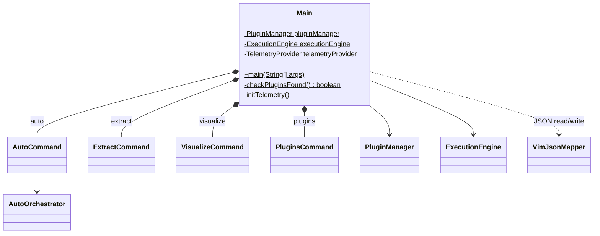
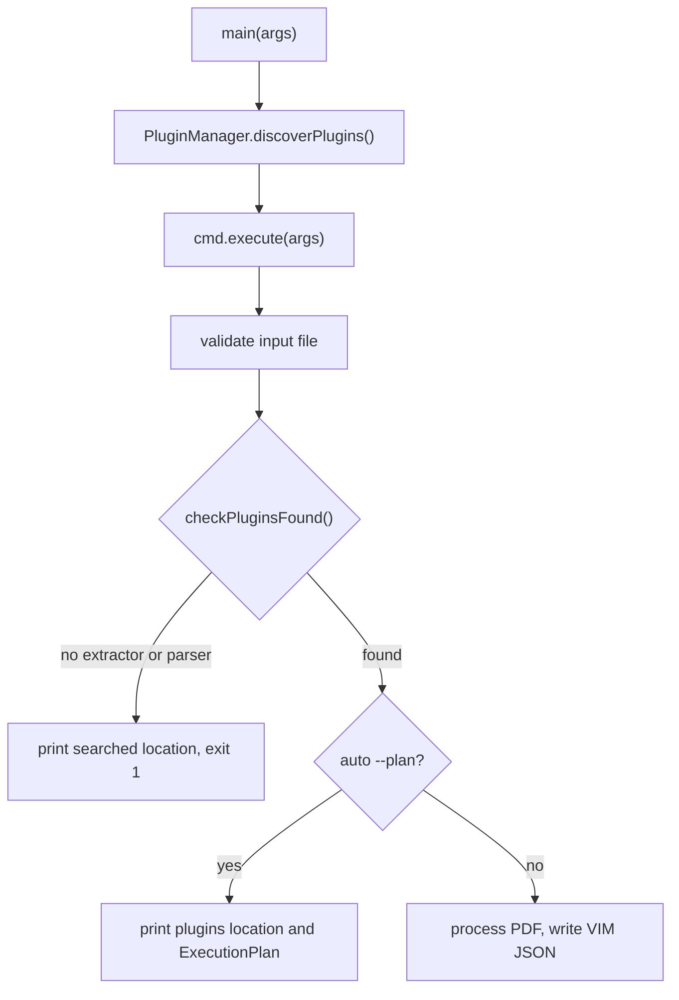

# Main

picocli entry point of `vim-parser`. It sets up logging, discovers plugins, builds the
execution engine and telemetry, and runs one of the subcommands.

## Structure

## Subcommands

| Command | Purpose |
| ------- | ------- |
| `auto` | Run all plugins in dependency order via `AutoOrchestrator`; `--plan` shows the plan |
| `extract` | Run selected plugins via `ExecutionEngine` |
| `visualize` | Render a VIM JSON file to HTML, read with strict scalar types |
| `plugins` | List discovered plugins |

## Main Flow of `auto` and `extract`

Without plugins nothing is written, so a caller never gets an empty VIM document with exit
code 0.

All JSON mappers come from `VimJsonMapper`: `auto` and `extract` write with `writer(indent)`,
`visualize` reads with `strictReader()`, so a scalar of the wrong type fails the load (#192).
