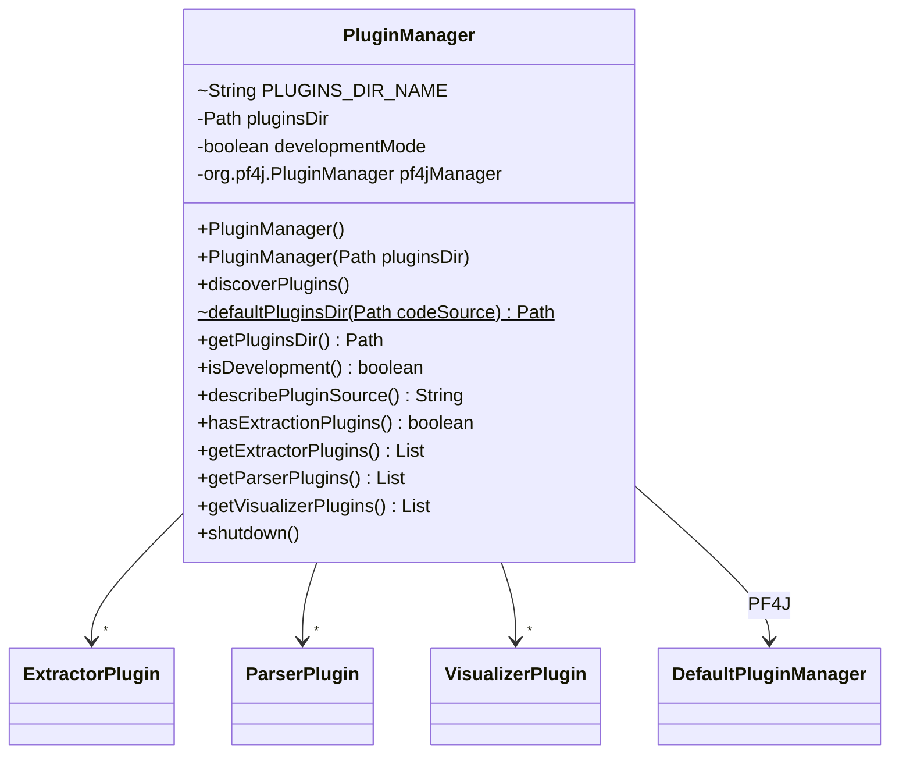
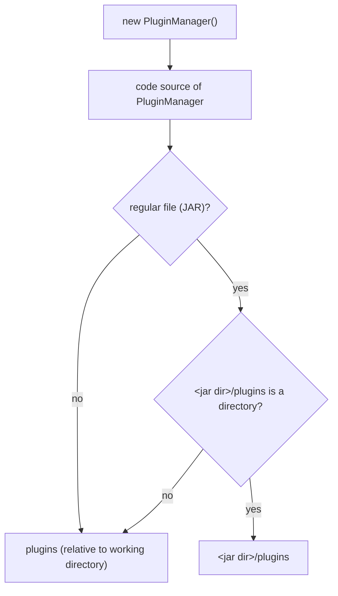
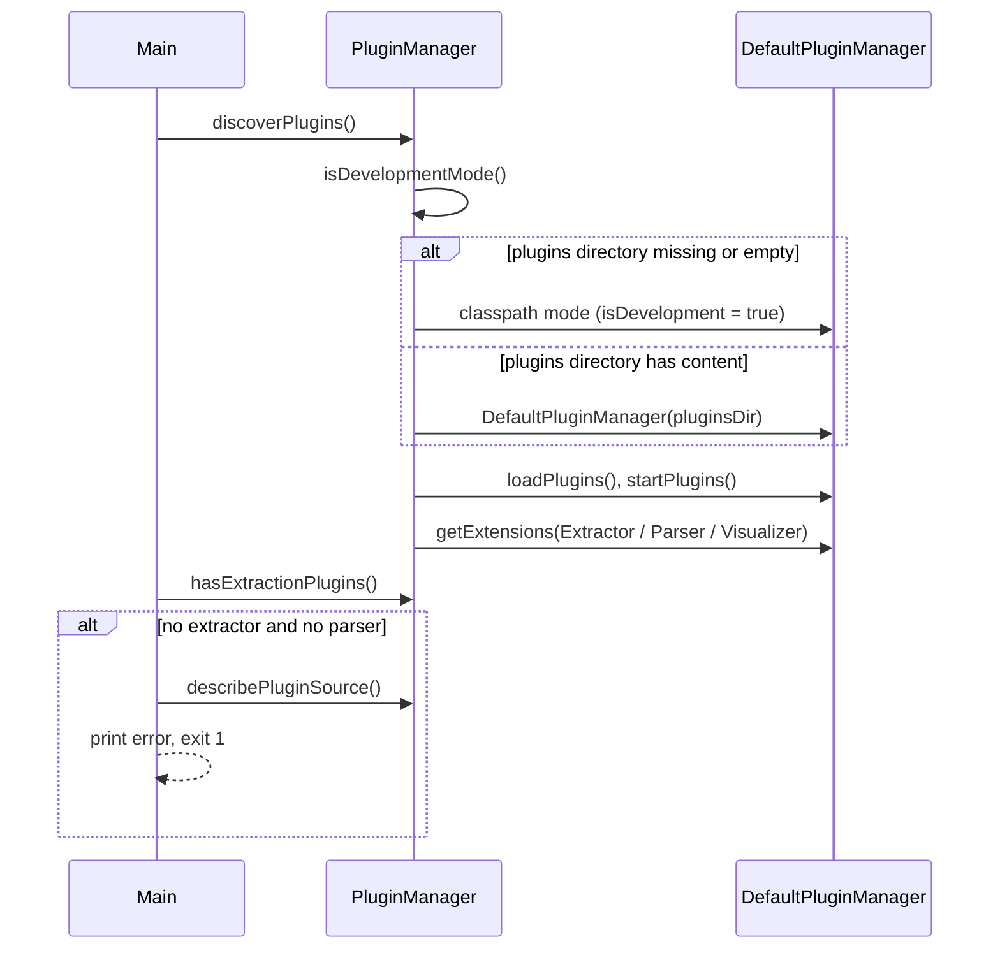

# PluginManager

Discovers vim-parser plugins with PF4J and keeps them by type: extractors, parsers and
visualizers. It also tells the CLI where plugins were looked for, so that a run without
plugins can fail with a clear message instead of writing an empty document.

## Structure

## Default Plugins Directory

The no-argument constructor resolves the plugins directory from the location of the
running code, so an installed JAR finds its plugins from any working directory.

A classes directory (IDE, unit tests) keeps the relative `plugins` directory.

## Discovery

`describePluginSource()` returns the absolute plugins directory, or a classpath note naming
that directory in development mode.
