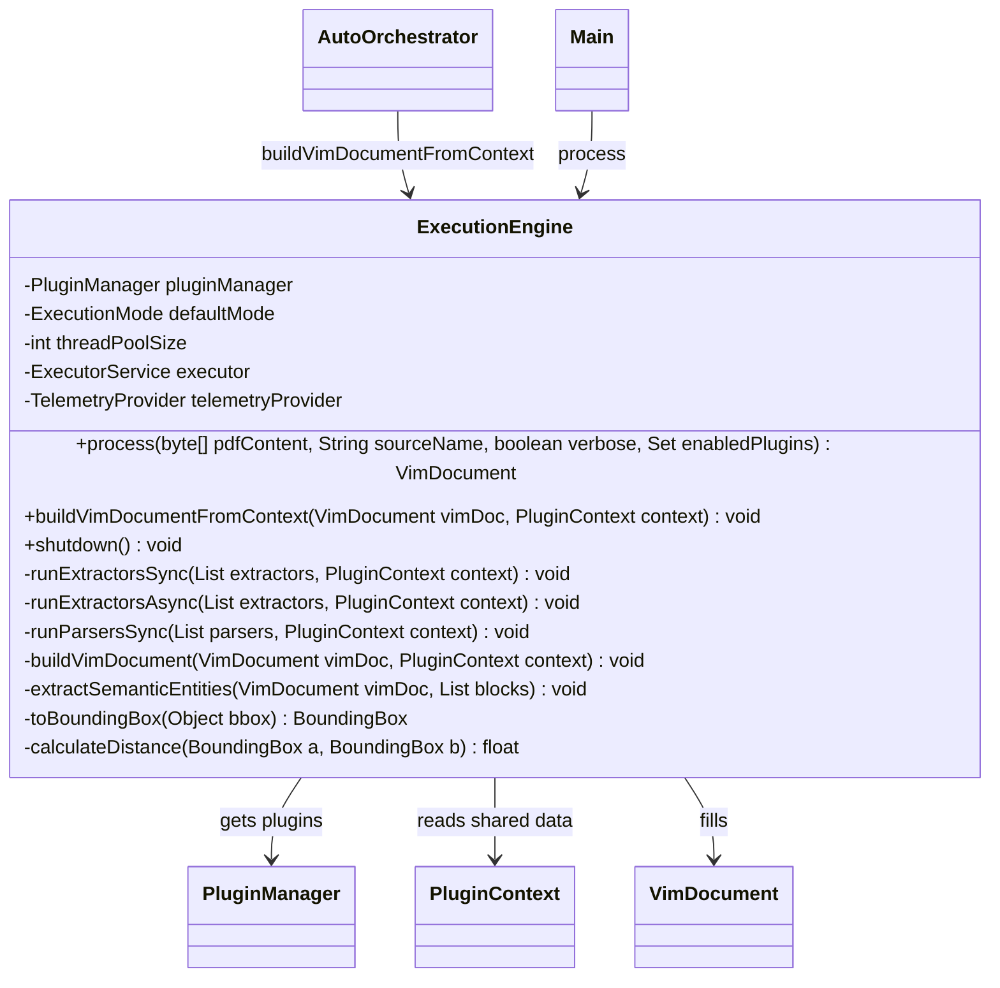
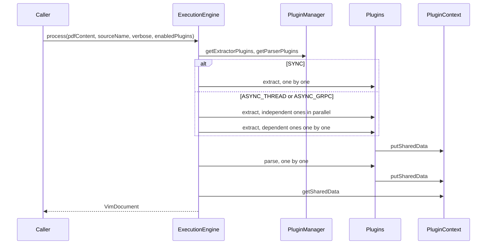
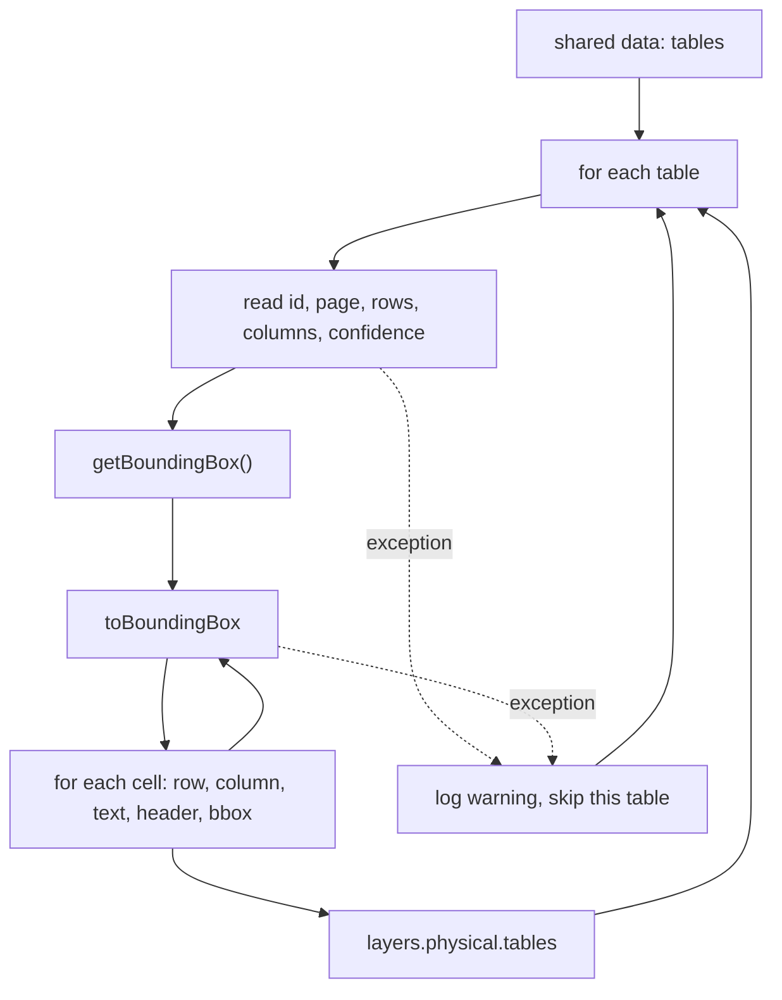
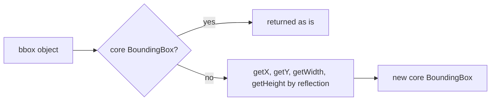

# ExecutionEngine

Runs the extractor and parser plugins over one PDF and builds the `VimDocument` from the
results the plugins left in the shared data of `PluginContext`.

The engine has two entry points. `process` runs the plugins itself and then builds the
document. `buildVimDocumentFromContext` only builds the document and is used by
`AutoOrchestrator`, which runs the plugins on its own.

## Structure

## Processing Flow

`ASYNC_GRPC` is not implemented and falls back to the thread mode. A plugin whose dependency
did not succeed is skipped. A plugin that throws is logged and recorded as a failed result,
the run continues.

## Shared Data Mapping

`buildVimDocument` reads these keys. A missing key is skipped.

| Shared data key    | Target in `VimDocument`                               | Version set |
| ------------------ | ----------------------------------------------------- | ----------- |
| `textBlocks`       | `layers.physical.blocks`, `layers.structural.blocks`  |             |
| `pageCount`        | `document.pages`                                      |             |
| `barcodes`         | `layers.physical.barcodes`, `layers.structural`       | 1.1         |
| `spaydPayments`    | `layers.semantic.payments`                            |             |
| `tables`           | `layers.physical.tables`                              |             |
| `textBlocks`       | `layers.semantic.entities`, by header keywords        |             |
| `documentMetadata` | `document.metadata`                                   | 1.2         |
| `fulltextContent`  | `layers.physical.fulltext`                            | 1.2         |
| `stemmingResult`   | `layers.semantic.stemming`                            | 1.3         |
| `toc`              | `layers.toc`, marks structural blocks of the TOC page | 1.4         |

## Table Conversion

The core has no compile dependency on the table plugin, so the tables are read by reflection.
The table plugin returns its own `BoundingBox` class from `table-detector-api`. It has the
same fields as the core class but is a different type, so `toBoundingBox` copies the values
instead of casting.

A table that cannot be converted is skipped with the warning `Error converting table` and
does not stop the other tables.
