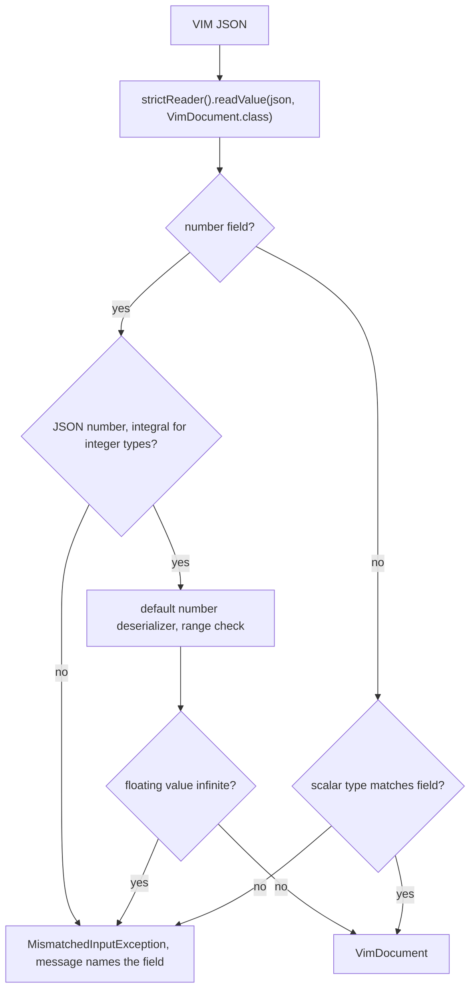

# VimJsonMapper

Shared factory of the Jackson mappers that read and write VIM documents in `vim-parser-core`.
The reader is strict on scalar types: a JSON scalar of the wrong type is a load error, not a
silent conversion. Decision of issue #192 (option 2), `vim-parser-api` stays annotations-only.

## Structure

```mermaid
classDiagram
    class VimJsonMapper {
        <<final>>
        +strictReader()$ ObjectMapper
        +writer(boolean indent)$ ObjectMapper
        -strictNumberModule()$ SimpleModule
    }
    class StrictNumberDeserializer {
        -JsonDeserializer delegate
        -boolean integral
        +deserialize(JsonParser, DeserializationContext) Object
    }
    class Main
    VimJsonMapper +-- StrictNumberDeserializer : int, long, double, float and wrappers
    StrictNumberDeserializer --> NumberDeserializers : delegates valid numbers
    Main ..> VimJsonMapper : visualize reads, auto/extract write
    VimJsonMapper ..> ObjectMapper : builds
```

## Strict Coercion Rules

| Target type | Rejected JSON input |
| ----------- | ------------------- |
| `String` | integer, float, boolean |
| `int`, `Integer`, `long`, `Long` | any string, number with a non-zero fractional part |
| `double`, `Double`, `float`, `Float` | any string, including `"NaN"` and `"Infinity"`; number that overflows to Infinity |
| `boolean`, `Boolean` | string, empty string, integer |

An integral float such as `245.0` or `1e2` is accepted in an integer field, as the JSON Schema
`integer` type does. An array or an object in a `String` field is already a load error with the
default settings.

Numbers are checked by `StrictNumberDeserializer`, not by the coercion config: the default
floating deserializer accepts the strings `"NaN"` and `"Infinity"` before any coercion config
applies, and the coercion config can only truncate a fractional number, not reject it selectively.
A finite JSON number such as `1e400` overflows to Infinity in a `double`, and the writer would
write it back as the string `"Infinity"`, so it is a range error. Underflow such as `1e-400` is
read as `0.0`.

Untyped fields (`Object`, `Map<String, Object>`, such as `value`, `params` and `rule`) are not
covered by `StrictNumberDeserializer`. The reader enables `USE_BIG_DECIMAL_FOR_FLOATS`, so a float
there is read as an exact `BigDecimal`: `1e400` is written back as the number `1E+400`, not as the
string `"Infinity"`, and `1.10` keeps its scale.

Unknown properties stay tolerated for forward compatibility.

## Read Flow



Readers outside `vim-parser-core` that create their own mapper stay lenient.
