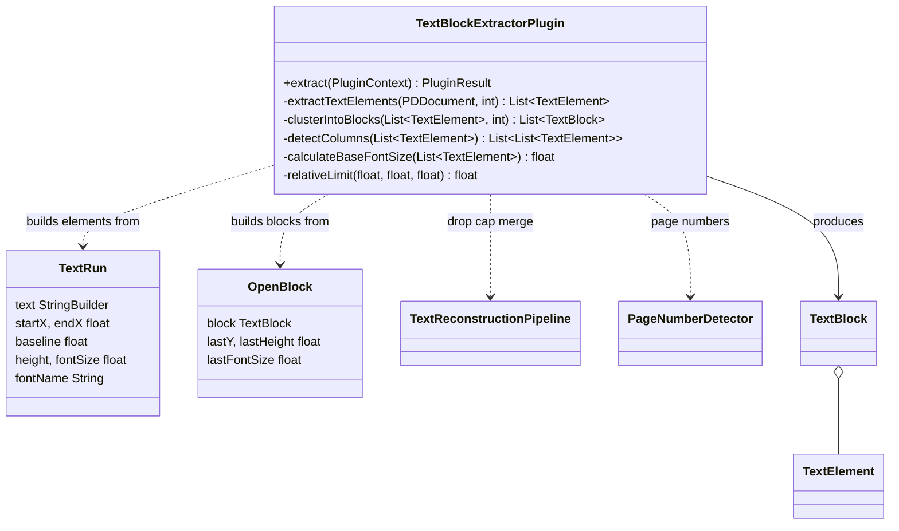
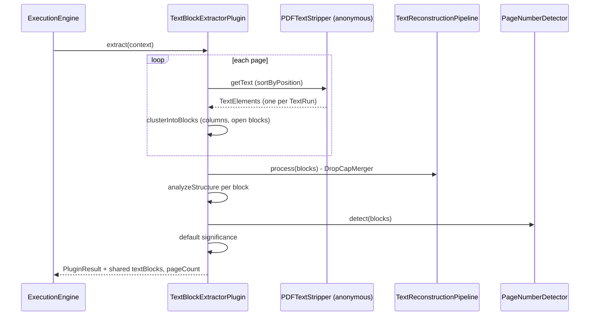
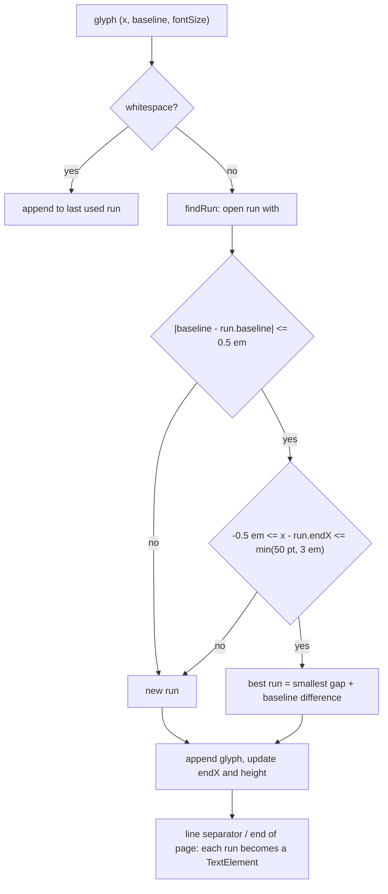
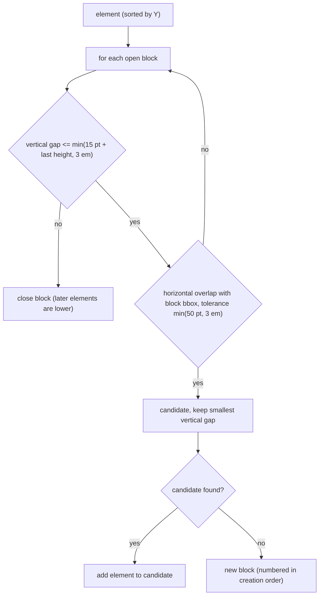

# vim-parser-fulltext / TextBlockExtractorPlugin

First extractor of the vim-parser pipeline (plugin id `fulltext`, priority 10). It reads the PDF with
PDFBox, builds positioned **text elements** (one label or line fragment each), clusters them into
**text blocks**, runs the text reconstruction (drop caps), classifies the blocks and stores them in the
shared context under `textBlocks` for later plugins (TOC, lemmatizer, table, ...).

## Structure

## Main path

## Text elements from runs

PDFBox groups glyphs into one line whenever their vertical extents overlap and sorts them by X. On
drawings this mixes labels that sit near each other in height. The stripper therefore keeps several
open **runs** per PDFBox line and assigns each glyph to the run it continues:

- The em is the font size of the glyph itself, so a large drop cap does not absorb the body text
  next to it
- Two labels on the same baseline with a gap above `min(50 pt, 3 em)` become two elements
- Two labels on different baselines never share an element, so their letters are not interleaved

## Clustering into blocks

Elements are sorted by Y, then split into columns (`detectColumns`, boundaries voted by at least two
lines). Within a column several blocks stay open at the same time:

- Without the horizontal check, labels at the same height in different parts of a large drawing
  sheet joined into one block as wide as the sheet (issue #201)
- The font-relative limits only tighten the absolute ones, so normal body text (about 10 pt) keeps
  the previous thresholds; small drawing labels get proportionally smaller ones
