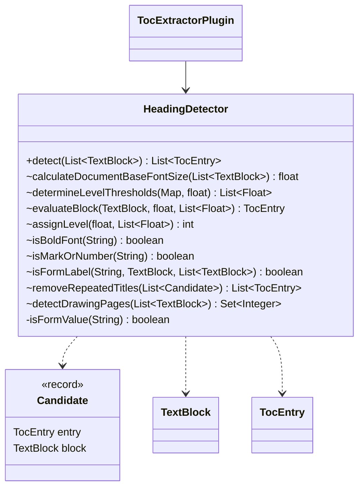
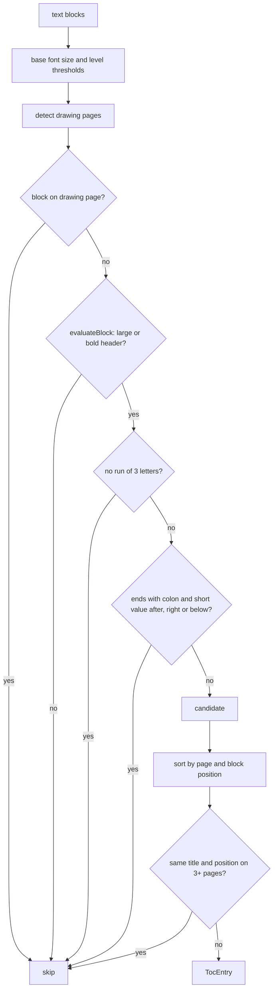

# HeadingDetector

Heuristic heading detection for the `toc` layer. A block is a heading candidate when its header
(set by `TextBlock.analyzeStructure`) is larger than the document base font size by 15 % or is
bold, or when a short block starts with text larger than the base size by 30 %. The heading level
(1–3) comes from the distinct heading font sizes.

Candidates are then filtered as noise (issue #202):

- **Drawing pages**: 10 or more blocks spread over a sheet larger than A3 (longer side above
  1300 pt) and less than 20 % of blocks are running text (8+ words). The heuristic does not run
  on these pages
- **Numbers, dimensions, marks**: a title without a run of 3 letters or 2 CJK characters
  (`1.05`, `A101`, `±0,000`, `A`). Two-letter Latin titles (`AI`, `WC`) are rejected as well
- **Form labels**: a title ending with `:` followed by a short value (1–6 words) in the element
  after the label, in an element to the right on the same row (gap up to 200 pt), or right below
  it aligned to the left edge. Only the first value line is judged, so a heading followed by a
  paragraph or by running text in a second column stays a heading
- **Repeated titles**: the same title at the same position (±10 pt, clustered transitively) on
  3 or more pages, such as page headers and repeated table column labels. Candidates are first
  grouped by normalized title, so clustering is linear for distinct titles

Candidates are sorted by page and by the vertical position of their own source block.

## Structure

## Flow

