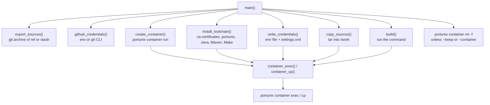
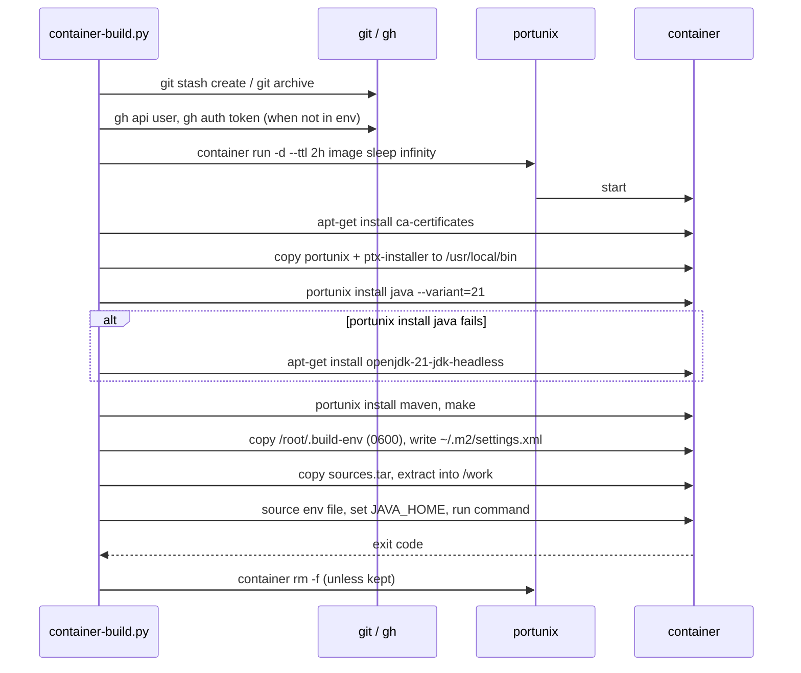

# Container Build

## Overview

`container-build.py` builds and tests the repository in a clean container, so the result does not
depend on the host (`~/.m2`, installed JDK, native libraries). It uses only `portunix container`
and `portunix install`, never `docker` or `podman` directly.

It is a uv inline script (PEP 723) with no third-party dependencies:

```bash
uv run scripts/container-build.py
uv run scripts/container-build.py --ref feature/003-ci-table-detector-artifacts
uv run scripts/container-build.py --keep --command "make verify"
uv run scripts/container-build.py --container vim-build-1234 --command "make build"
```

`make container-verify` runs the default command (the same Maven command as the CI workflow).

## Options

| Option              | Default        | Meaning                                                          |
| ------------------- | -------------- | ---------------------------------------------------------------- |
| `-r`, `--ref`       | working tree   | git ref to build; default includes uncommitted tracked changes   |
| `-c`, `--command`   | CI Maven call  | command run in the repository root inside the container          |
| `-i`, `--image`     | `ubuntu:24.04` | container image                                                  |
| `-j`, `--java`      | `21`           | Java variant for `portunix install java`                         |
| `-s`, `--server-id` | `github`       | Maven server id for GitHub Packages, repeatable                  |
| `-n`, `--name`      | generated      | name of the new container                                        |
| `--container`       | none           | reuse a prepared container, skip the toolchain install           |
| `-k`, `--keep`      | off            | keep the container after the build                               |
| `--ttl`             | `2h`           | auto-remove the container after this time                        |

Exit code: the exit code of the build command, or `2` when a preparation step fails.

## Structure



## Main Flow



## Design Notes

- **Sources from git**: the build sees exactly the tracked files (`git stash create` captures
  uncommitted changes without touching the working tree); untracked files and `target/` never
  enter the container
- **Credentials**: GitHub Packages needs a token even for public packages. The token is written to
  a local `0600` temporary file, copied to `/root/.build-env` and deleted locally; `settings.xml`
  refers to it through `${env.GITHUB_ACTOR}` and `${env.GITHUB_TOKEN}`, so the token never appears
  on a command line
- **Login shell**: commands run through `bash -lc`, so PATH changes that `portunix install` writes
  into `~/.profile` apply
- **Java fallback**: when the Portunix Java download fails, the distribution JDK is installed and
  a warning is printed; `JAVA_HOME` is derived from the `javac` found on PATH
- **Exit code**: `portunix container exec` currently returns `1` for any failure, so only success
  or failure of the build is reliable, not the exact code
